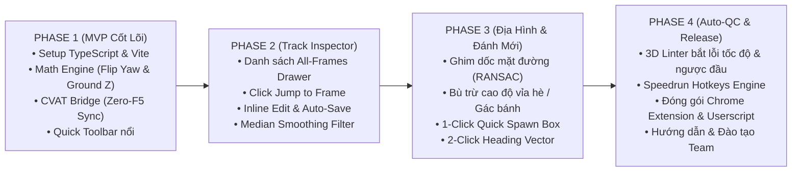

# KẾ HOẠCH TRIỂN KHAI HỆ THỐNG: CVAT 3D SUITE EXTENSION
> **Tên dự án:** CVAT 3D Point Cloud Annotation & Alignment Assistant  
> **Phiên bản tài liệu:** 1.0  
> **Chiến lược:** Triển khai từng bước (Phase-by-Phase), kiểm thử chắc chắn từng tính năng trước khi mở rộng, đảm bảo không làm gián đoạn công việc hiện tại của đội ngũ gán nhãn.

---

## 1. TỔNG QUAN LỘ TRÌNH 4 GIAI ĐOẠN (ROADMAP OVERVIEW)

---

## 2. CHI TIẾT TỪNG GIAI ĐOẠN TRIỂN KHAI

---

### GIAI ĐOẠN 1: MVP CỐT LÕI & GIẢI QUYẾT TRIỆT ĐỂ BÀI TOÁN "ZERO-F5"
> **Mục tiêu:** Xây dựng bộ khung dự án và chứng minh cơ chế can thiệp trực tiếp vào RAM của CVAT để đổi kích thước & lật hướng Yaw trong 1 mili-giây mà không cần F5.  
> **Mức độ ưu tiên:** P0 (Tối quan trọng)

#### Danh sách công việc (Tasks):
- [ ] **Task 1.1 - Khởi tạo môi trường phát triển (Scaffolding):**
  - Khởi tạo `package.json`, cấu hình TypeScript (`tsconfig.json`) và Vite bundler (`vite.config.ts`).
  - Cấu hình script đóng gói xuất file `dist/cvat-3d-suite.user.js` có gắn Tampermonkey header.
- [ ] **Task 1.2 - Xây dựng Module Toán học (`src/core/geometry.ts`):**
  - Hàm `flipYaw(yaw: number): number` (Đảo ngược $180^\circ$ và chuẩn hóa về $[-\pi, \pi]$).
  - Hàm `calculateGroundLockedZ(oldZ, oldH, newH): number` (Cố định mặt tiếp xúc bánh xe với mặt đường).
  - Viết Unit Test tự động cho cả 2 hàm trong `tests/geometry.test.ts`.
- [ ] **Task 1.3 - Xây dựng CVAT Bridge can thiệp RAM (`src/cvat/bridge.ts`):**
  - Truy cập context trình duyệt, tìm instance đối tượng `cvat` hoặc Redux Store / Three.js canvas.
  - Viết hàm ghi đè dữ liệu trực tiếp vào Client Cache trong RAM và trigger Canvas vẽ lại tức thì.
- [ ] **Task 1.4 - Dựng Thanh công cụ nổi tối giản (`src/ui/components/QuickToolbar.ts`):**
  - Nút bấm `[Flip 180° Yaw]` (Lật đầu xe).
  - Nút bấm `[Lock Sedan]` và `[Lock SUV]` (Áp dụng kích thước chuẩn kèm bù trừ Z).
  - Đóng gói file `.user.js` và test trực tiếp trên link CVAT thật.

#### Tiêu chuẩn hoàn thành (Definition of Done - DoD):
1. Người dùng mở tab CVAT 3D, thanh toolbar xuất hiện ở góc phải màn hình.
2. Click chọn 1 chiếc xe ➔ Bấm nút `[Flip 180° Yaw]` ➔ Chiếc xe quay ngược đầu ngay tức khắc trên màn hình 3D mà **hoàn toàn không cần F5 trình duyệt**.
3. Bấm `[Lock Sedan]` ➔ Chiếc xe đổi về kích thước $4.60 \times 1.80 \times 1.45m$, bánh xe tiếp xúc khít mặt đường, không bị lún hay bay lơ lửng.

---

### GIAI ĐOẠN 2: BẢNG TRACK INSPECTOR & ĐỒNG BỘ REALTIME
> **Mục tiêu:** Chuyển đổi hoàn toàn sang mô hình Track-Centric, giúp người dùng nhìn thấy toàn bộ các frame của một track và chỉnh sửa siêu tốc.  
> **Mức độ ưu tiên:** P0

#### Danh sách công việc (Tasks):
- [ ] **Task 2.1 - Observer lắng nghe chọn đối tượng (`src/cvat/observer.ts`):**
  - Tự động bắt sự kiện khi người dùng click chọn 1 đối tượng trên màn hình hoặc trên danh sách bên trái của CVAT.
  - Đọc toàn bộ danh sách các frame mà đối tượng đó xuất hiện.
- [ ] **Task 2.2 - Xây dựng Bảng Track Inspector Drawer (`src/ui/components/TrackInspector.ts`):**
  - Panel trượt từ cạnh phải màn hình hiển thị bảng ma trận: `Frame #`, `Tọa độ X, Y, Z`, `Yaw`, `L, W, H`, `Loại Frame (Keyframe/Nội suy)`.
  - Nút `[Jump]` trên từng dòng: Click là timeline của CVAT lập tức chuyển đến frame tương ứng, camera 3D zoom vào xe.
- [ ] **Task 2.3 - Chỉnh sửa trực tiếp & Debounce Auto-Save (`src/cvat/api.ts`):**
  - Cho phép người dùng sửa trực tiếp các con số trên bảng.
  - Sử dụng cơ chế Debounce 300ms: Tự động gom các thao tác chỉnh sửa để gửi request lưu ngầm về server CVAT.
- [ ] **Task 2.4 - Nút Median Smoothing Filter:**
  - Nút tính trung vị kích thước: Tự động quét toàn bộ frame, lấy giá trị Median của $L, W, H$ ép cho tất cả các frame để triệt tiêu rung giật.

#### Tiêu chuẩn hoàn thành (DoD):
1. Chọn xe ➔ Bảng mở ra liệt kê đủ toàn bộ frame của xe đó.
2. Bấm vào bất kỳ dòng nào ➔ Timeline CVAT nhảy ngay đến frame đó.
3. Sửa số ô nào ➔ Màn hình 3D ăn ngay và biểu tượng lưu thành công báo xanh.

---

### GIAI ĐOẠN 3: THÍCH ỨNG ĐỊA HÌNH & ĐÁNH MỚI CHO OBJECT CHƯA CÓ BOX
> **Mục tiêu:** Xử lý triệt để bài toán đường dốc, vỉa hè và tăng tốc 80% thời gian vẽ mới đối tượng chưa được AI phát hiện (Nhánh 2).  
> **Mức độ ưu tiên:** P1

#### Danh sách công việc (Tasks):
- [ ] **Task 3.1 - Ghim mặt đường dốc (`src/core/terrain.ts`):**
  - Trích xuất điểm LiDAR mặt đất xung quanh gầm xe trong bán kính 3m.
  - Thuật toán RANSAC ước lượng mặt phẳng đường cục bộ.
  - Tự động bẻ góc **Pitch** (dốc dọc) và **Roll** (nghiêng ngang), giữ nguyên góc **Yaw** và hút mặt đáy xe tiếp đất.
- [ ] **Task 3.2 - Thích ứng cao độ Vỉa hè & Đỗ gác bánh (Curb Offset):**
  - Nút `[Vỉa hè]` (Nâng cao độ đáy $+15cm$).
  - Nút `[Gác vỉa hè (Half-Curb)]`: Tự động tính góc nghiêng thân xe $\arcsin(H_{curb} / W_{car})$ và nâng tâm $Z$.
- [ ] **Task 3.3 - 1-Click Quick Box Spawn (Nhánh 2):**
  - Nhấn phím nóng (`C` - Car, `T` - Truck, `B` - Bus) và click vào cụm điểm LiDAR ➔ Sinh ngay 1 box chuẩn kích thước catalog tiếp xúc mặt đất.
- [ ] **Task 3.4 - 2-Click Heading Vector:**
  - Giữ phím `V`, click điểm đuôi ➔ click điểm đầu ➔ Tự xoay hướng Yaw chuẩn trong 1 giây.
- [ ] **Task 3.5 - Rigid Track Interpolation:**
  - Khóa kích thước cố định khi tạo track mới giữa Frame đầu và Frame cuối.

#### Tiêu chuẩn hoàn thành (DoD):
1. Xe nằm trên đường dốc bấm `[G]` ➔ Thân xe tự nghiêng khớp với mặt dốc, không bị đâm xuyên đường.
2. Vẽ xe mới từ con số 0 chỉ mất chưa đầy 3 giây (bấm phím tạo box ➔ click 2 điểm hướng chạy ➔ xong).

---

### GIAI ĐOẠN 4: AUTO-QC LINTER, SPEEDRUN HOTKEYS & PHÂN PHỐI TOÀN CÔNG TY
> **Mục tiêu:** Tự động bắt lỗi dữ liệu, tối đa hóa tốc độ bằng phím tắt và đóng gói sản phẩm hoàn thiện.  
> **Mức độ ưu tiên:** P1 ➔ P2

#### Danh sách công việc (Tasks):
- [ ] **Task 4.1 - Bộ quy tắc Auto-QC Linter (`src/core/linter.ts`):**
  - Quy tắc phát hiện xe đảo chiều Yaw đột ngột ($> 90^\circ$).
  - Quy tắc phát hiện xe nhảy vọt vận tốc phi lý ($> 120km/h$ hoặc giật lùi).
  - Quy tắc phát hiện xe lún lòng đường hoặc bay lơ lửng ($> 15cm$).
  - Tự động bôi đỏ/vàng các frame bị lỗi trên bảng Inspector.
- [ ] **Task 4.2 - Bộ phím tắt thao tác nhanh (Speedrun Hotkeys Engine):**
  - Phím `F` (Flip Yaw), Phím `1..4` (Catalog presets), Phím `G` (Snap Road), Phím `[` / `]` (Nhảy đến frame lỗi kế tiếp).
  - Nút gạt bật/tắt phím tắt để tránh xung đột.
- [ ] **Task 4.3 - Đóng gói Chrome Extension Manifest V3 (`src/extension/`):**
  - Cấu hình file `manifest.json`, icon ứng dụng.
  - Đóng gói thư mục `dist/extension` sẵn sàng nạp Chrome cho cả công ty.
- [ ] **Task 4.4 - Đào tạo & Bàn giao:**
  - Soạn tài liệu hướng dẫn sử dụng nhanh cho đội ngũ Annotator và QC.

---

## 3. BẢNG PHÂN BỔ THỜI GIAN DỰ KIẾN (TỔNG CỘNG ~8-10 NGÀY LÀM VIỆC)

| Giai đoạn | Nội dung chính | Thời gian dự kiến | Đầu ra kiểm tra được |
| :--- | :--- | :---: | :--- |
| **Phase 1** | Khởi tạo repo, Math Engine, CVAT Bridge (Zero-F5), Toolbar | **2 ngày** | Script Tampermonkey test đổi size và lật Yaw tức thì |
| **Phase 2** | Track Inspector Drawer, Jump Frame, Inline Edit, Auto-Save | **2.5 ngày** | Bảng quản lý toàn bộ frame, sửa đâu lưu đó |
| **Phase 3** | Ghim mặt đường, Vỉa hè, 1-Click Spawn xe mới, 2-Click Yaw | **2.5 ngày** | Thao tác mượt mà trên dốc, vẽ xe mới trong 3 giây |
| **Phase 4** | Auto-QC Linter, Hotkeys, Đóng gói Chrome Extension | **2 ngày** | Bản Extension chính thức phân phối cho toàn team |
