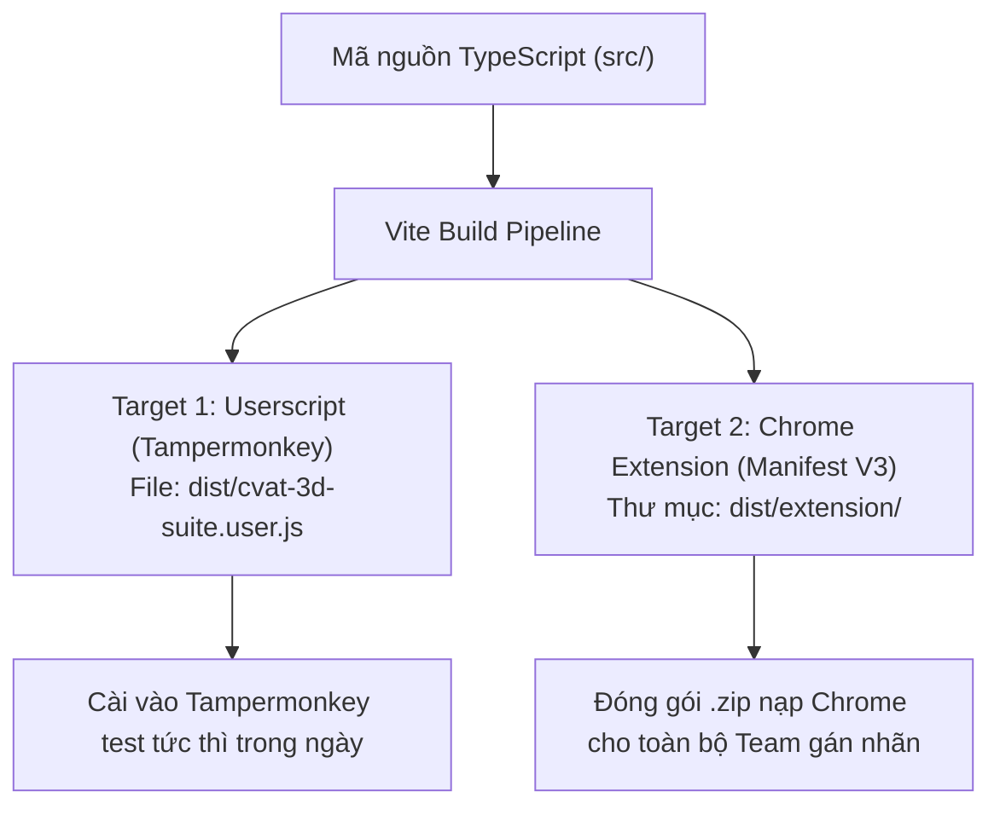

# TÀI LIỆU KIẾN TRÚC HỆ THỐNG: CVAT 3D SUITE EXTENSION
> **Tên dự án:** CVAT 3D Point Cloud Annotation & Alignment Assistant  
> **Phiên bản:** 1.0  
> **Ngày lập:** 2026-10-20  
> **Mục tiêu kiến trúc:** Thiết kế hệ thống theo mô hình phân tầng độc lập (Layered Architecture), tuân thủ nguyên tắc Clean Code & Single Responsibility, hỗ trợ cơ chế build kép (Dual-Target: vừa là Tampermonkey Userscript vừa là Chrome Extension Manifest V3), tối ưu hóa khả năng bảo trì và mở rộng lâu dài.

---

## 1. NGUYÊN TẮC THIẾT KẾ CỐT LÕI (CORE DESIGN PRINCIPLES)

1. **Phân tách mối quan tâm (Separation of Concerns - SoC):**
   * **Core / Math:** Không dính dáng đến DOM, HTML hay bất kỳ thư viện giao diện nào. 100% là hàm toán học thuần túy (Pure Functions).
   * **CVAT Adapter:** Đóng gói toàn bộ các thao tác can thiệp bộ nhớ (RAM), Hook React/Redux/Window và gọi REST API của CVAT vào một tầng riêng biệt.
   * **Presentation (UI):** Chỉ chịu trách nhiệm hiển thị bảng điều khiển, bắt sự kiện người dùng và render dữ liệu.
2. **Khả năng cách ly & Thay thế linh hoạt (Loose Coupling):**
   * Nếu CVAT server nâng cấp phiên bản hoặc đổi cấu trúc DOM, lập trình viên chỉ cần cập nhật duy nhất thư mục `src/cvat/`, toàn bộ UI và logic tính toán 3D giữ nguyên vẹn.
3. **An toàn kiểu dữ liệu (Type Safety & Zero Runtime Surprises):**
   * 100% mã nguồn sử dụng TypeScript với cấu hình nghiêm ngặt (`strict: true`). Mọi đối tượng 3D Cuboid và mảng điểm 16 phần tử của CVAT đều được map thành Interface tường minh.
4. **Một mã nguồn - Hai đầu ra (Single Source of Truth - Dual Build):**
   * Cùng một codebase, hệ thống build tự động sinh ra:
     - `dist/cvat-3d-suite.user.js` (dành cho Tampermonkey / Violentmonkey).
     - `dist/extension/` (dành cho Chrome Extension Manifest V3 đóng gói chính thức).

---

## 2. SƠ ĐỒ CẤU TRÚC THƯ MỤC CHI TIẾT (PROJECT DIRECTORY TREE)

```
edit_w_l_t/
├── docs/                                # Thư mục tài liệu dự án
│   ├── USECASE_3D_EXTENSION.md          # Đặc tả 16 Use Cases & 2 Nhánh quy trình
│   └── PROJECT_ARCHITECTURE.md          # Tài liệu kiến trúc & Thiết kế kỹ thuật
│
├── src/                                 # TOÀN BỘ MÃ NGUỒN CHÍNH
│   │
│   ├── core/                            # TẦNG 1: LOGIC TOÁN HỌC & NGHIỆP VỤ THUẦN TÚY
│   │   ├── types.ts                     # Định nghĩa kiểu: Cuboid3D, Track, FrameData, CatalogPreset
│   │   ├── geometry.ts                  # Toán học 3D: Flip Yaw, Ground-Lock Δz, Quần đảo Euler
│   │   ├── terrain.ts                   # Thuật toán ghim dốc đường (RANSAC) & góc nghiêng vỉa hè
│   │   ├── linter.ts                    # Bộ quy tắc Auto-QC: Kiểm tra tốc độ, ngược đầu, lún đất
│   │   └── interpolator.ts              # Thuật toán nội suy khóa cứng kích thước (Rigid Interpolation)
│   │
│   ├── cvat/                            # TẦNG 2: TƯƠNG TÁC NỘI BỘ VỚI CVAT (CVAT Adapter)
│   │   ├── bridge.ts                    # Hook vào window.cvat / Redux / Three.js (Cập nhật Zero-F5)
│   │   ├── api.ts                       # Gọi REST API /api/jobs/{id}/annotations/ ngầm để lưu server
│   │   ├── parser.ts                    # Chuyển đổi qua lại giữa points[0..15] của CVAT và Cuboid3D
│   │   └── observer.ts                  # Lắng nghe sự kiện click chọn Track trên màn hình 3D
│   │
│   ├── ui/                              # TẦNG 3: GIAO DIỆN NGƯỜI DÙNG (Presentation Layer)
│   │   ├── components/
│   │   │   ├── QuickToolbar.ts          # Thanh công cụ nổi tiện tay (Nút Flip, Ghim dốc, Preset)
│   │   │   ├── TrackInspector.ts        # Bảng ma trận danh sách tất cả các frame (Drawer trượt)
│   │   │   ├── CatalogPicker.ts         # Menu chọn nhanh dòng xe (Sedan, SUV, Truck, Bus...)
│   │   │   └── LinterBadge.ts           # Huy hiệu cảnh báo lỗi đỏ/vàng trên từng dòng frame
│   │   ├── icons/                       # Các icon SVG nhỏ gọn (Flip, Lock, Jump, Warning)
│   │   └── styles.css                   # Giao diện Dark Mode đồng bộ tuyệt đối với CVAT UI
│   │
│   ├── config/                          # TẦNG 4: CẤU HÌNH & THƯ VIỆN KÍCH THƯỚC XE
│   │   ├── presets.ts                   # Thư viện kích thước chuẩn các dòng xe (Catalog Catalog)
│   │   └── hotkeys.ts                   # Cấu hình danh mục phím tắt tốc độ cao (F, C, T, B, G...)
│   │
│   ├── extension/                       # Tệp cấu hình dành riêng cho Chrome Extension
│   │   ├── manifest.json                # Chrome Extension Manifest V3
│   │   └── background.ts                # Service Worker nền của Extension
│   │
│   ├── userscript.header.js             # Metadata Header cho Tampermonkey Userscript
│   └── index.ts                         # Điểm khởi động chính (Entry Point liên kết các tầng)
│
├── tests/                               # BỘ KIỂM THỬ TỰ ĐỘNG (Unit Tests)
│   ├── geometry.test.ts                 # Kiểm tra tính toán Flip Yaw và bù trừ tâm Ground-Lock Z
│   ├── terrain.test.ts                  # Kiểm tra công thức góc nghiêng vỉa hè và dốc đường
│   └── linter.test.ts                   # Kiểm tra độ nhạy của bộ phát hiện dị thường Auto-QC
│
├── backups/                             # Thư mục lưu trữ bản sao lưu annotations khi cần
├── edit_cuboid.py                       # Script Python CLI hiện có (Dùng cho CI/CD hoặc Pipeline ngoài)
├── package.json                         # Khai báo dependencies, scripts build
├── tsconfig.json                        # Cấu hình TypeScript Compiler
├── vite.config.ts                       # Cấu hình Vite build ra Userscript và Chrome Extension
└── README.md                            # Hướng dẫn cài đặt & vận hành dự án
```

---

## 3. ĐẶC TẢ CHI TIẾT CÁC TẦNG CHỨC NĂNG

### 3.1. Tầng 1: Core Domain (`src/core/`)
* **Trách nhiệm:** Lưu trữ toàn bộ mô hình dữ liệu và công thức toán học.
* **Quy chuẩn kỹ thuật:**
  * Tuyệt đối không `import` từ `src/cvat/` hoặc `src/ui/`.
  * Các hàm toán học nhận tham số đầu vào và trả về giá trị mới (Immutability):
    ```typescript
    // Ví dụ trong geometry.ts:
    export function flipYaw(currentYaw: number): number {
      let newYaw = currentYaw + Math.PI;
      while (newYaw > Math.PI) newYaw -= 2 * Math.PI;
      while (newYaw < -Math.PI) newYaw += 2 * Math.PI;
      return Number(newYaw.toFixed(4));
    }

    export function calculateGroundLockedZ(oldZ: number, oldH: number, newH: number): number {
      const deltaH = newH - oldH;
      return Number((oldZ + deltaH / 2).toFixed(4));
    }
    ```

### 3.2. Tầng 2: CVAT Adapter (`src/cvat/`)
* **Trách nhiệm:** Cầu nối trung gian với hệ thống CVAT.
* **Cơ chế hoạt động:**
  1. **Bridge (`bridge.ts`):** 
     * Truy cập vào ngữ cảnh trình duyệt thông qua `window` / `unsafeWindow`.
     * Tìm đối tượng `cvat` toàn cục hoặc hook vào Redux Store / React Fiber node của canvas 3D.
     * Cung cấp các hàm cập nhật trực tiếp vào RAM: `updateShapeInMemory(trackId, frame, newPoints)`.
     * Trigger Canvas Three.js vẽ lại đối tượng tức thì mà **hoàn toàn không cần F5**.
  2. **API (`api.ts`):**
     * Thực hiện các lệnh PATCH ngầm gửi về server CVAT với cơ chế **Debounce (300ms)** để gom nhiều thao tác sửa ô thành 1 request duy nhất.
  3. **Parser (`parser.ts`):**
     * Ánh xạ chính xác cấu trúc 16 phần tử của CVAT 3D:
       ```
       points[0..2] = center_x, center_y, center_z
       points[3..5] = rot_x (Roll), rot_y (Pitch), rot_z (Yaw)
       points[6]    = Length (chiều dài)
       points[7]    = Width (chiều rộng)
       points[8]    = Height (chiều cao)
       ```

### 3.3. Tầng 3: Presentation UI (`src/ui/`)
* **Trách nhiệm:** Hiển thị giao diện tương tác tiện ích, trực quan, không che khuất tầm nhìn điểm LiDAR.
* **Các thành phần UI:**
  * **QuickToolbar:** Nằm cố định ở góc trên/phải màn hình, thu nhỏ thành 1 icon khi không dùng. Khi chọn một chiếc xe, thanh toolbar tự động bung ra các nút thao tác nhanh: `[Flip Yaw]`, `[Sedan]`, `[SUV]`, `[Snap Road]`, `[Inspector]`.
  * **TrackInspector:** Một thanh trượt bên phải (Right Drawer) dạng bảng, liệt kê đầy đủ các frame. Hỗ trợ click đúp chuyển frame tức thì, sửa trực tiếp ô số liệu, và tự động đổi màu cảnh báo lỗi dị thường.
* **CSS & Thẩm mỹ:**
  * Thiết kế theo phong cách Dark Mode chuyên nghiệp, sử dụng bảng màu tương phản nhẹ (`#1f1f1f`, `#141414`, viền `#333`, điểm nhấn `#1890ff` và `#52c41a`), hòa nhập mượt mà vào giao diện mặc định của CVAT.

### 3.4. Tầng 4: Config (`src/config/`)
* **Trách nhiệm:** Lưu trữ thông số danh mục xe và cấu hình phím tắt.
* **Dễ dàng tùy biến:** Khi dự án chuyển sang thị trường khác (Mỹ, Nhật, Việt Nam), chỉ cần thay đổi file `presets.ts` mà không cần đụng đến logic code.

---

## 4. CHIẾN LƯỢC ĐÓNG GÓI DUAL-BUILD (`vite.config.ts`)

Quy trình tự động hóa chuyển đổi mã nguồn thành 2 phiên bản:



* **Lệnh build cho Tampermonkey:** `npm run build:userscript`  
  $\rightarrow$ Tự động gộp mã nguồn + gắn phần Header metadata (`// ==UserScript== ...`) vào đầu file.
* **Lệnh build cho Chrome Extension:** `npm run build:extension`  
  $\rightarrow$ Tự động copy `manifest.json`, icons và sinh bundle file `content.js`, `background.js`.

---

## 5. QUY TRÌNH KIỂM THỬ TỰ ĐỘNG (TESTING STRATEGY)

Trước khi đóng gói hoặc release phiên bản mới cho team gán nhãn, bộ Unit Test tự động (chạy qua Vitest / Jest) sẽ kiểm tra nghiêm ngặt:
1. **Geometry Tests (`tests/geometry.test.ts`):**
   * Lật Yaw $0^\circ \rightarrow 180^\circ$, $90^\circ \rightarrow -90^\circ$, bảo đảm không bị tràn góc ngoài $[-\pi, \pi]$.
   * Bù trừ Z khi thay đổi chiều cao xe: $H$ tăng từ $1.4m$ lên $1.8m$ thì $Z$ phải dịch lên đúng $+0.2m$ để mặt đáy không đổi.
2. **Terrain Tests (`tests/terrain.test.ts`):**
   * Tính toán góc nghiêng khi bánh xe leo lên vỉa hè $15cm$.
3. **Linter Tests (`tests/linter.test.ts`):**
   * Đưa vào một chuỗi frame giả lập: phát hiện chính xác frame bị nhảy vọt vận tốc hoặc frame bị ngược đầu đột ngột.

---

## 6. LỘ TRÌNH TRIỂN KHAI THEO CẤU TRÚC (IMPLEMENTATION PHASES)

* **Phase 1 (Khởi tạo khung xương & Core):** Khởi tạo `package.json`, cấu hình TypeScript, viết các hàm toán học trong `src/core/` và các unit test tương ứng.
* **Phase 2 (CVAT Bridge & Zero-F5):** Xây dựng `src/cvat/bridge.ts` và `src/cvat/parser.ts` để can thiệp RAM, kiểm tra cơ chế cập nhật màn hình 3D không cần F5.
* **Phase 3 (QuickToolbar UI):** Dựng thanh công cụ nổi với các nút chức năng cốt lõi (Flip Yaw, Khóa Catalog Sedan/SUV/Truck).
* **Phase 4 (TrackInspector Drawer):** Xây dựng bảng ma trận toàn bộ frame, cơ chế click nhảy frame và debounce auto-save.
* **Phase 5 (Terrain & New Object Spawn):** Tích hợp tính năng ghim dốc đường, vỉa hè và khởi tạo xe mới 1-click.
