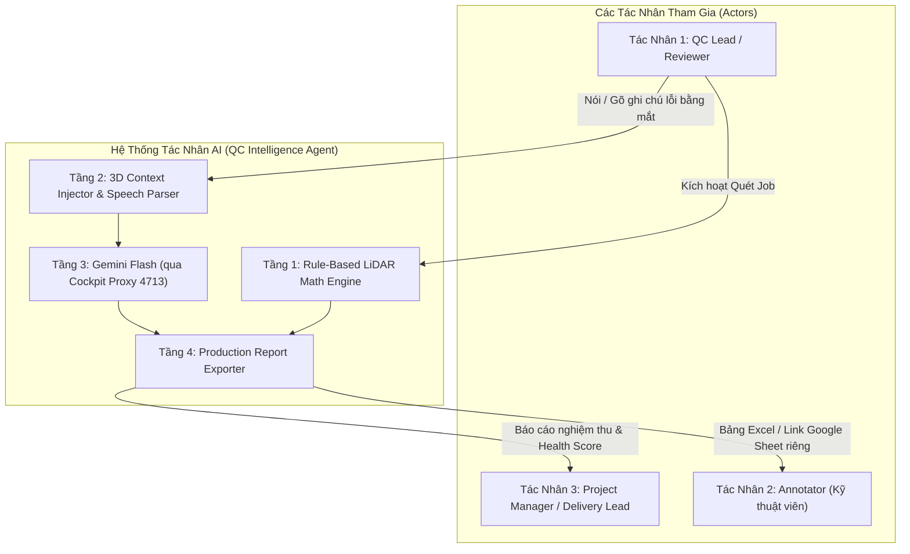
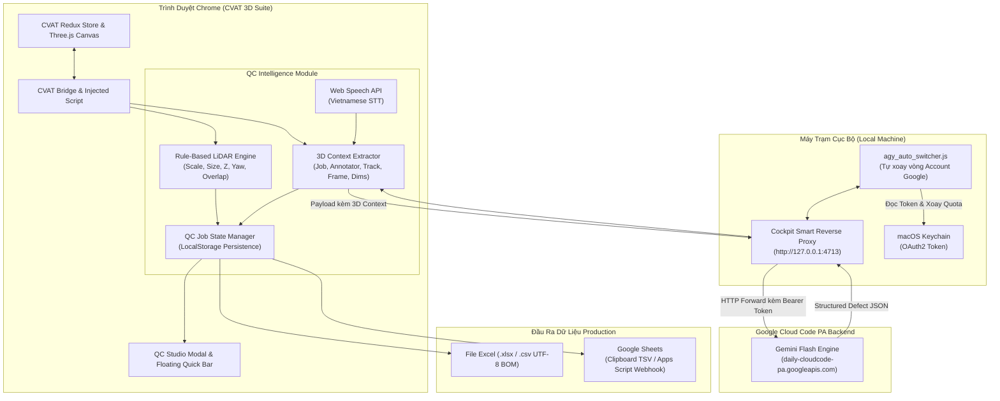

# ĐẶC TẢ TÁC NHÂN QC INTELLIGENCE & QUY TRÌNH NGHIỆP VỤ (PRODUCTION SPECIFICATION)

> **Tài liệu:** CVAT 3D QC Intelligence Suite & LLM-Powered Review Workflow  
> **Mã tài liệu:** `DOC-QC-AGENT-PROD-01`  
> **Phiên bản:** 1.0 (Production Architecture)  
> **Ngày lập:** 2026-10-25  
> **Tác giả:** Staff / Principal Engineer  
> **Trạng thái:** Approved for Implementation  
> **Phạm vi:** Trình duyệt Chrome, CVAT 3D Point Cloud Canvas, Cockpit Tools Smart Proxy, Google Sheets / Excel Pipeline  

---

## 1. TỔNG QUAN HỆ THỐNG & NỖI ĐAU NGHIỆP VỤ (PROBLEM STATEMENT)

### 1.1. Thực Trạng & Điểm Nghẽn Trong Khâu QC Dữ Liệu 3D LiDAR

Trong các dự án dán nhãn dữ liệu xe tự hành (Autonomous Driving 3D LiDAR Annotation):
- **Chi phí thời gian vô ích quá cao**: Một chuyên viên QC (Quality Control Lead / Reviewer) dành tới **60% - 70% thời gian của một ca làm việc** chỉ để gõ bàn phím lặp đi lặp lại:
  * Nhìn số Frame, gõ lại số Frame.
  * Nhìn Object ID (Track ID), gõ lại `#12`.
  * Gõ văn bản mô tả lỗi: *"bị lệch mép trái, box hơi cao, class bị nhầm"*.
  * Copy-paste thủ công từng dòng vào bảng Excel hoặc Google Sheets để gửi cho Annotator sửa.
- **Rủi ro sai lệch dữ liệu do thao tác tay**: Gõ nhầm số Frame (ví dụ Frame 45 gõ thành 54), gõ nhầm Track ID khiến Annotator sửa sai đối tượng, làm chu kỳ sửa bài (Rework Loop) kéo dài gấp đôi.
- **Phân mảnh theo Job & Annotator**: Mỗi Job trên CVAT do một Annotator phụ trách riêng biệt. Việc quản lý lẫn lộn giữa các Job dẫn đến báo cáo bị chồng chéo, không thể đánh giá KPI và tỷ lệ lỗi (Error Rate) chính xác cho từng nhân sự.

### 1.2. Mục Tiêu Đột Phá Của Hệ Thống QC Intelligence

Hệ thống kết hợp **3 sức mạnh công nghệ cốt lõi**:
1. **Rule-Based 3D LiDAR Auto-Scan**: Tự động phát hiện 100% các lỗi toán học và vật lý (lệch sàn, sai kích thước catalog, nhảy góc Yaw, bay lơ lửng, chồng lấn BEV) trong thời gian $< 1.5\text{s}$ cho toàn bộ Job.
2. **Context-Aware LLM Assistant (Gemini Flash qua Cockpit Proxy `127.0.0.1:4713`)**: Người QC chỉ cần chọn xe, nói một câu ngắn 3 giây bằng tiếng Việt (qua Chrome Web Speech API) hoặc gõ vắn tắt:
   * Tool tự động bắt trọn ngữ cảnh: `Job ID`, `Annotator ID`, `Frame`, `Track ID`, `Class Label`, `Bounding Box Dimensions`.
   * LLM tự động chuẩn hóa thành câu mô tả lỗi kỹ thuật chuyên nghiệp, phân loại danh mục lỗi và đưa ra hướng dẫn khắc phục cụ thể cho annotator.
3. **Automated Production Packaging (1-Click Google Sheets & Excel .xlsx)**:
   * Tự động sinh báo cáo độc lập cho từng Job với tên file: `QC_Job[ID]_[AnnotatorID]_[Date].xlsx`.
   * Hỗ trợ nút **Copy TSV 1-Click** để dán thẳng vào Google Sheets định dạng chuẩn có màu sắc, filter và trạng thái kiểm duyệt.

---

## 2. MA TRẬN PHÂN TÍCH TÁC NHÂN (ACTOR PERSPECTIVE MATRIX)



### 2.1. Tác Nhân 1: QC Lead / Reviewer (Người Kiểm Định Chất Lượng)
- **Mục tiêu**: Soi và bắt sạch mọi lỗi trong Job với tốc độ cao nhất, không bị mỏi tay hay mất tập trung vì việc nhập liệu hành chính.
- **Hành vi thực tế**:
  1. Mở Job CVAT, bấm nút **`Quét Job`** -> Hệ thống quét toàn bộ frame trong 1 giây, gom các lỗi tự động vào bảng.
  2. Bật toggle **`Voice QC Mode`**:
     * Lia mắt trên 3D Canvas / Camera Overlay.
     * Thấy xe bị lỗi -> Click chọn xe (hoặc bấm phím tắt focus).
     * Giữ phím `V` nói: *"đầu xe lấn vạch, class này đổi sang xe cứu thương"*.
     * Nhả phím `V` -> Dòng lỗi chuẩn chỉnh đã được chèn vào bảng.
  3. Bấm **`Tải Excel`** hoặc **`Copy Google Sheets`** gửi cho Annotator.

### 2.2. Tác Nhân 2: Annotator (Kỹ Thuật Viên Gán Nhãn)
- **Mục tiêu**: Nhận phản hồi rõ ràng, chính xác 100% về vị trí lỗi, không bị mơ hồ, sửa đúng ngay lần đầu tiên.
- **Hành vi thực tế**:
  1. Mở file Excel hoặc link Google Sheet mang tên mình (`QC_Job18294_HungNV.xlsx`).
  2. Đọc danh sách: Cột **Frame**, cột **Track ID**, **Mô tả lỗi trực quan** và **Cách khắc phục**.
  3. Bấm vào link Frame nhảy thẳng tới đối tượng cần sửa trên CVAT.
  4. Đổi trạng thái từ `Cần Sửa` -> `Đã Sửa` và nộp lại bài.

### 2.3. Tác Nhân 3: Project Manager / Delivery Lead (Quản Lý Dự Án)
- **Mục tiêu**: Giám sát chất lượng dự án theo thời gian thực, đo lường năng lực của từng annotator, phục vụ nghiệm thu khách hàng.
- **Dữ liệu thu được**:
  * Chỉ số **Health Score** trung bình của từng Job.
  * Ma trận phân bổ lỗi: Annotator nào hay mắc lỗi lệch sàn, ai hay mắc lỗi sai nhãn, ai vẽ box bị phình to.

### 2.4. Tác Nhân 4: QC Intelligence Agent (Hệ Thống AI Tự Động)
- **Trách nhiệm**: Đảm bảo không làm giảm hiệu năng của CVAT (giữ vững 60 FPS), điều phối luồng gọi LLM qua cổng loopback local, tự động bắt lỗi và định dạng dữ liệu đầu ra không sai sót.

---

## 3. KIẾN TRÚC KỸ THUẬT & LUỒNG DỮ LIỆU ĐA TẦNG

### 3.1. Sơ Đồ Kiến Trúc Hệ Thống (Architecture Diagram)



---

## 4. BỘ QUY CHUẨN PHÂN LOẠI LỖI (DEFECT TAXONOMY & CATALOG)

Hệ thống phân loại toàn bộ lỗi trong gán nhãn 3D thành 4 nhóm nghiệp vụ lớn:

| Mã Nhóm | Tên Nhóm Lỗi | Cơ Chế Phát Hiện | Các Lỗi Con Phổ Biến | Mức Độ |
| :---: | :--- | :---: | :--- | :---: |
| **G-01** | **Hình Học & Tiếp Đất (Geometry & Ground)** | Tự động 100% (Math Engine) | - Đáy box lơ lửng cách mặt đường $> 10\text{cm}$<br/>- Đáy box lún âm vào lòng đất $> 6\text{cm}$<br/>- Nghiêng Roll/Pitch trên đường phẳng | 🔴 Error / 🟡 Warning |
| **S-02** | **Kích Thước & Scale (Size & Rigid Consistency)** | Tự động 100% (Math Engine) | - Kích thước $L, W, H$ ngoài giới hạn Catalog<br/>- Biến thiên kích thước giữa các frame $> 3\text{cm}$<br/>- Box phình to do ôm lẫn điểm mặt đất | 🔴 Error / 🟡 Warning |
| **T-03** | **Quỹ Đạo & Hướng Xoay (Trajectory & Heading)** | Tự động 100% (Math Engine) | - Nhảy góc Yaw đột ngột $> 75^\circ$<br/>- Ngược hướng vận tốc chuyển động (Yaw flip)<br/>- Chồng lấn đa giác BEV (Overlapping boxes) | 🔴 Error |
| **M-04** | **Ngữ Nghĩa & Nhãn (Semantic & Classification)** | Bằng Mắt + LLM (Visual & Gemini) | - Nhầm Class (Xe đạp $\leftrightarrow$ Xe máy, Xe con $\leftrightarrow$ Xe tải)<br/>- Bỏ sót đối tượng trong bóng râm/góc khuất<br/>- Đánh thừa vật thể rác / cây cối / biển báo | 🔴 Error |
| **B-05** | **Bám Biên & Căn Mép (Boundary & Edge Fit)** | Bằng Mắt + LLM (Visual & Gemini) | - Cản trước thụt sâu so với mây đón tia<br/>- Mép sườn lấn sang vỉa hè / làn xe khác<br/>- Ôm trùm cả bóng ma kéo dài (Ghosting) | 🟡 Warning |

---

## 5. ĐẶC TẢ CHI TIẾT CÁC USE CASE NGHIỆP VỤ (USE CASE SPECIFICATIONS)

### UC-QC-01: Quét Lỗi Tự Động Toàn Job (Automated Pre-Scan)
- **Mục đích**: Chạy thuật toán LiDAR Math Engine để rà soát 100% các frame và track trong Job, phát hiện ngay các lỗi hình học.
- **Tiền điều kiện**: Người QC đang mở một Job 3D LiDAR trên CVAT.
- **Luồng sự kiện chính**:
  1. Người QC nhấn nút **`Quét Toàn Job`** trên thanh công cụ hoặc mở QC Studio (`Shift + Q`).
  2. Hệ thống gọi `CVATBridge.fetchJobAnnotations(jobId)`.
  3. `QCEngine.evaluateJob()` duyệt qua từng Object Instance:
     * Tính toán kiểm tra Scale đồng bộ (`scale`).
     * Kiểm tra ngưỡng Catalog (`size`).
     * Kiểm tra độ cao $Z$ và tiếp xúc mặt đất (`z`, `ground_mismatch`).
     * Kiểm tra góc xoay và vector vận tốc (`rot`, `motion_mismatch`).
     * Kiểm tra va chạm giao cắt hình học 2D trên mặt phẳng bằng (`overlap`).
  4. Hệ thống tổng hợp `QCJobReport`, tính điểm sức khỏe dữ liệu **Health Score (0 - 100)** và hiển thị lên bảng Matrix/Table.
- **Kết quả**: Bảng lỗi ban đầu của Job được khởi tạo đầy đủ.

---

### UC-QC-02: Nhận Diện & Quản Lý Metadata Job / Annotator ID
- **Mục đích**: Đảm bảo mọi lỗi được gắn chính xác với mã Job và mã nhân sự phụ trách, tạo dữ liệu độc lập cho từng file Excel.
- **Cơ chế thu thập Annotator ID**:
  * **Mức 1 (Tự động từ CVAT Redux)**: Đọc từ `state.annotation.job.instance.assignee`. Nếu có `username` hoặc `id`, tự động điền.
  * **Mức 2 (Nhập nhanh có ghi nhớ)**: Nếu Job trên CVAT không gán assignee, hiển thị ô input nhỏ: `👤 Annotator ID: [ ...... ]`.
  * **Mức 3 (Ghi nhớ Cache)**: Lưu cặp giá trị `job_{jobId}_annotator` vào `localStorage`. Khi chuyển tab hoặc mở lại Job, thông tin tự động phục hồi mà không cần nhập lại.

---

### UC-QC-03: Ghi Chú Nhanh Bằng Lời Nói / Text & Bơm Ngữ Cảnh 3D (Context Injection)
- **Mục đích**: Người QC ghi nhận lỗi bằng mắt chỉ trong 3 giây mà không cần gõ bàn phím nhập lại Frame hay ID.
- **Luồng sự kiện chính**:
  1. Người QC click chọn đối tượng bị lỗi trên Canvas 3D (hoặc danh sách Sidebar).
  2. Bấm giữ phím tắt `V` (hoặc click icon Micro trên widget QC nổi):
     * Thanh ghi âm kích hoạt (Chrome Web Speech API lắng nghe ngôn ngữ `vi-VN`).
     * Người QC nói: *"sườn trái bị lấn ra ngoài mây điểm khoảng 15 phân, cản trước thụt vào"*.
  3. Người QC nhả phím `V`:
     * Web Speech API hoàn tất chuyển giọng nói thành text tiếng Việt.
     * **Module Context Extractor** lập tức trích xuất dữ liệu của object đang active:
       ```json
       {
         "jobId": 18294,
         "annotatorId": "HungNV",
         "frame": 45,
         "trackId": 12,
         "label": "car",
         "box": { "l": 4.65, "w": 2.15, "h": 1.62, "z": -0.85, "yawDeg": 32.4 },
         "reviewerRawNote": "sườn trái bị lấn ra ngoài mây điểm khoảng 15 phân, cản trước thụt vào"
       }
       ```
  4. Hệ thống chuyển tiếp payload này sang **UC-QC-04** để LLM xử lý.

---

### UC-QC-04: Chuẩn Hóa Lỗi Qua Gemini Flash (Local Proxy `127.0.0.1:4713`)
- **Mục đích**: Biến lời nói đời thường vắn tắt thành mô tả kỹ thuật chuẩn QA Production.
- **Cơ chế giao tiếp Upstream**:
  - Endpoint: `http://127.0.0.1:4713/v1internal:generateContent` (hoặc endpoint CloudCode format tương ứng).
  - Không cần cung cấp API Key (Proxy cục bộ tự động chèn OAuth2 Token từ pool tài khoản Antigravity active trên máy).
- **System Prompt Định Dạng Chuyên Nghiệp**:
  ```text
  Bạn là Chuyên gia Đánh giá Chất lượng Dữ liệu 3D LiDAR (Lead 3D QA/QC Engineer).
  Nhiệm vụ: Nhận ngữ cảnh 3D của đối tượng và ghi chú thô của Reviewer, chuẩn hóa thành 1 bản ghi lỗi chuẩn Production.
  Quy tắc phản hồi: Trả về DUY NHẤT một JSON object không bọc markdown thừa:
  {
    "category": "Bám biên & Căn mép" | "Kích thước" | "Tiếp đất" | "Sai nhãn" | "Quỹ đạo" | "Khác",
    "severity": "error" | "warning",
    "formalDescription": "Mô tả chuẩn kỹ thuật bằng tiếng Việt rõ ràng, ngắn gọn, súc tích",
    "actionGuide": "Chỉ dẫn thao tác cụ thể cho annotator (ví dụ: kéo mép nào, chỉnh tâm trục nào, đổi nhãn gì)"
  }
  ```
- **Xử lý kết quả trả về**:
  - JSON được phân tích cú pháp (parse) an toàn.
  - Tự động tạo một đối tượng `QCDefectItem` mới và chèn trực tiếp vào danh sách lỗi của Job.
  - Phát âm thanh phản hồi nhẹ (subtle click) hoặc hiển thị toast xanh: *"Đã ghi nhận lỗi Track #12 (Frame 45)"*.

---

### UC-QC-05: Xuất Báo Cáo Excel Phân Tách Theo Từng Job / Annotator
- **Mục đích**: Tải xuống file Excel hoàn chỉnh gửi cho annotator hoặc nộp nghiệm thu.
- **Đặc tả định dạng file**:
  * Tên file: `QC_Job[JobID]_[AnnotatorID]_[YYYYMMDD].xlsx` (hoặc `.csv` UTF-8 kèm BOM).
  * Mã hóa: UTF-8 with BOM (`\uFEFF`) đảm bảo mở trực tiếp trên Microsoft Excel tiếng Việt không bao giờ bị lỗi font.
- **Cấu trúc bảng tính**:
  1. **Khối Header Thông Tin Dự Án**:
     * Job ID, Task ID, Annotator ID, Reviewer Name, Thời gian quét, Điểm Health Score.
  2. **Khối Danh Sách Lỗi Chi Tiết**:
     * Cột 1: `STT`
     * Cột 2: `Frame` (Kèm link mở trực tiếp frame trên CVAT)
     * Cột 3: `Track ID` (Định dạng `#ID`)
     * Cột 4: `Class / Label`
     * Cột 5: `Nguồn Phát Hiện` (`Auto-LiDAR` hoặc `Reviewer + LLM`)
     * Cột 6: `Phân Loại Lỗi`
     * Cột 7: `Mức Độ` (🔴 Nghiêm trọng / 🟡 Cảnh báo)
     * Cột 8: `Mô Tả Chi Tiết Lỗi` (Đã được LLM chuẩn hóa)
     * Cột 9: `Hướng Dẫn Khắc Phục`
     * Cột 10: `Trạng Thái Sửa` (`Chờ Sửa` / `Đã Sửa` / `Chấp Nhận`)

---

### UC-QC-06: 1-Click Sync Sang Google Sheets (Clipboard TSV & Webhook)
- **Mục đích**: Đưa toàn bộ báo cáo lên Google Sheets trong 1 giây để gửi link cho annotator mà không cần tải file về máy.
- **Phương án A: Nút `📋 Copy Google Sheets` (Clipboard TSV - Siêu Nhanh)**:
  * Hệ thống chuyển đổi toàn bộ bảng lỗi thành cấu trúc Tab-Separated Values (`\t` và `\n`).
  * Ghi vào Clipboard hệ thống qua `navigator.clipboard.writeText()`.
  * Annotator hoặc QC chỉ cần mở link Google Sheet bất kỳ, nhấn `Ctrl+V` (Cmd+V): toàn bộ dữ liệu tự động dàn đều vào từng cột, giữ nguyên tiêu đề và ngắt dòng chuẩn xác.
- **Phương án B: Google Apps Script Webhook (Tùy Chọn Tự Động)**:
  * Cho phép người dùng nhập URL Webhook Google Sheet trong Settings.
  * Mỗi khi ghi nhận lỗi hoặc khi bấm "Gửi Báo Cáo", tool gửi HTTP POST JSON lên Apps Script để tự động append dữ liệu vào Sheet.

---

## 6. THIẾT KẾ MÔ HÌNH DỮ LIỆU & SCHEMA CHI TIẾT (TYPESCRIPT INTERFACES)

```typescript
/**
 * src/core/qc/qc_agent_types.ts
 * Đặc tả cấu trúc dữ liệu cho QC Intelligence Agent
 */

export type QCDetectionSource = "auto_math" | "manual_llm";

export type QCDefectSeverity = "error" | "warning" | "info";

export type QCDefectCategory =
  | "geometry_ground"     // Lệch sàn, lơ lửng, lún đất
  | "size_consistency"    // Sai kích thước, phình to, rung giật
  | "heading_trajectory"  // Nhảy Yaw, ngược vận tốc, va chạm BEV
  | "boundary_fit"        // Lệch sườn đón tia, thụt cản trước/sau
  | "semantic_class"      // Sai class, nhầm xe, bỏ sót đối tượng
  | "data_structure";     // Lỗi cấu trúc track, outside thừa

export interface QCDefectItem {
  id: string;                     // UUID hoặc track_frame_timestamp
  jobId: number;                  // CVAT Job ID
  annotatorId: string;            // Mã định danh / Tên annotator
  frame: number;                  // Frame xuất hiện lỗi
  trackId: number;                // Track ID đối tượng
  label: string;                  // Class label hiện tại
  source: QCDetectionSource;      // Nguồn phát hiện lỗi
  category: QCDefectCategory;     // Phân loại danh mục lỗi
  severity: QCDefectSeverity;     // Mức độ nghiêm trọng
  formalDescription: string;      // Mô tả kỹ thuật chuẩn xác (LLM hoặc Rule sinh)
  actionGuide: string;            // Hướng dẫn annotator cách sửa
  measuredValue?: string;         // Giá trị đo đạc thực tế (ví dụ: Z = +0.18m, L = 5.8m)
  referenceThreshold?: string;    // Ngưỡng quy chuẩn (ví dụ: [-0.06m, +0.10m])
  status: "pending" | "fixed" | "accepted"; // Trạng thái xử lý lỗi
  createdAt: number;              // Timestamp thời điểm tạo
}

export interface QCJobMasterReport {
  jobId: number;
  taskId: number | null;
  annotatorId: string;
  reviewerName: string;
  scannedAt: number;
  healthScore: number;            // 0 - 100
  totalFrames: number;
  totalTracks: number;
  totalDefects: number;
  autoDefectsCount: number;
  manualDefectsCount: number;
  criticalCount: number;
  warningCount: number;
  defects: QCDefectItem[];
}
```

---

## 7. ĐẶC TẢ GIAO DIỆN NGƯỜI DÙNG (UI/UX DESIGN)

Theo đúng quy chuẩn **Clean White / Light Theme & 100% Flat SVG Icons** của [GEMINI.md](file:///Users/huynh/codes/edit_w_l_t/GEMINI.md):

### 7.1. Widget Ghi Chú Nhanh (QC Voice / Quick Dock)
- Vị trí: Dock nhỏ gọn neo góc phải dưới của Canvas 3D (không che khuất Perspective / Orthogonal Views).
- Các thành phần:
  1. **Badge Thông Tin**: `Job #18294` | `👤 Annotator: [HungNV]` (có thể click vào sửa nhanh).
  2. **Trạng Thái Đối Tượng**: Đang chọn `Track #12 (Car) @ Frame 45`.
  3. **Nút Micro Thu Âm (Flat SVG Mic)**:
     - Giữ phím `V`: Vòng tròn đổi sang màu đỏ nhẹ (`#ef4444`) với hiệu ứng sóng âm tối giản.
     - Nhả phím `V`: Icon xoay nhẹ biểu thị đang gửi Gemini Flash qua `127.0.0.1:4713`.
  4. **Ô Nhập Text Dự Phòng**: Nhập câu vắn tắt rồi nhấn `Enter` nếu không muốn dùng micro.
  5. **Nút Mở QC Studio (`Shift + Q`)**: Mở bảng danh sách lỗi toàn màn hình.

### 7.2. Bảng Điều Khiển QC Studio Đầy Đủ (Full-Screen Modal)
- Header: Tên Job, Tên Annotator, Health Score Gauge, Nút **`Xuất Excel (.xlsx)`**, Nút **`📋 Copy Google Sheets`**.
- Tab Phân Loại:
  - **Tất Cả Lỗi** (All Defects)
  - **Lỗi Tự Động (Auto-Scan)**
  - **Lỗi Đánh Giá Bằng Mắt (Manual / LLM)**
  - **Bộ Lọc Theo Frame & Track**
- Tương tác 2 chiều: Click vào bất kỳ dòng lỗi nào -> Tool tự động chuyển sang Frame đó và focus camera vào xe tương ứng.

---

## 8. PHÂN TÍCH RỦI RO, GÓC KHUẤT & PHƯƠNG ÁN PHÒNG VỆ (DEFENSIVE ENGINEERING)

| Rủi ro kỹ thuật / Nghiệp vụ | Khả năng | Tác động | Giải pháp xử lý triệt để (Zero-Regression) |
| :--- | :---: | :---: | :--- |
| **Tiến trình Cockpit Proxy `127.0.0.1:4713` chưa bật hoặc bị tắt** | Trung bình | Gây lỗi khi gọi LLM | **Graceful Degradation**: Kiểm tra `fetch("http://127.0.0.1:4713", { method: "HEAD" })`. Nếu không kết nối được, hiển thị thông báo nhẹ và tự động chuyển sang chế độ lưu text thô của người dùng vào bảng lỗi mà không làm nghẽn luồng. |
| **Chrome Web Speech API không nhận diện được giọng nói (phòng ồn)** | Thấp | Text bị sai lệch | Luôn hiển thị thanh xem trước (preview) text vừa nhận diện trong 1.5s trước khi submit, cho phép bấm `Enter` để sửa hoặc gõ tay nhanh. |
| **Xung đột phím tắt với CVAT native** | Cao | Phím `V` có thể trùng phím vẽ | Tùy biến phím tắt trong Settings, chỉ kích hoạt khi đang ở chế độ QC Mode hoặc sử dụng tổ hợp an toàn (`Alt + V` / `Shift + Space`). |
| **Mất dữ liệu lỗi khi annotator vô tình F5 reload trang** | Cao | Mất toàn bộ danh sách lỗi đã ghi | Tự động đồng bộ liên tục mảng `defects` vào `localStorage` theo key `qc_job_[jobId]_defects`. Mở lại trang là khôi phục 100%. |
| **File Excel mở trên máy Windows bị lỗi tiếng Việt có dấu** | Rất cao | Hỏng hiển thị văn bản | Bắt buộc chèn ký tự UTF-8 Byte Order Mark (`\uFEFF`) ở đầu chuỗi dữ liệu CSV/TSV, thiết lập charset `utf-8` chuẩn mực. |

---

## 9. LỘ TRÌNH TRIỂN KHAI THEO GIAI ĐOẠN (IMPLEMENTATION ROADMAP)

- **Phase 1: Quản Lý State & Metadata Job / Annotator**
  - Mở rộng [types.ts](file:///Users/huynh/codes/edit_w_l_t/src/core/qc/types.ts) thêm cấu trúc `QCDefectItem`, `QCJobMasterReport`.
  - Tự động trích xuất `jobId` và `assignee` từ CVAT Redux store, lưu trữ cache `localStorage`.
- **Phase 2: Bộ Kết Nối Cockpit Local Proxy & Gemini Flash**
  - Xây dựng `src/core/qc/qc_llm_client.ts` giao tiếp qua cổng `http://127.0.0.1:4713`.
  - Cấu trúc System Prompt chuẩn QA 3D LiDAR, parse JSON phòng vệ an toàn.
- **Phase 3: Tích Hợp Web Speech API & Voice-to-Text**
  - Xây dựng module nhận diện giọng nói tiếng Việt miễn phí không phụ thuộc thư viện ngoài.
  - Xây dựng cơ chế Context Injection (bơm Frame, Track ID, Bounding Box vào prompt).
- **Phase 4: Widget Ghi Chú Nhanh & Nâng Cấp QC Studio Modal**
  - Thêm Quick Voice Dock trên giao diện chính.
  - Cập nhật [QCStudioModal.ts](file:///Users/huynh/codes/edit_w_l_t/src/ui/components/QCStudioModal.ts) hỗ trợ tab hiển thị kết hợp lỗi Auto + Manual.
- **Phase 5: Pipeline Xuất Production Excel & Google Sheets 1-Click**
  - Tải file Excel gắn Job ID & Annotator ID.
  - Nút Copy Clipboard TSV dàn trang cực đẹp vào Google Sheets.
  - Kiểm thử toàn diện và verify build (`npm run build`).
