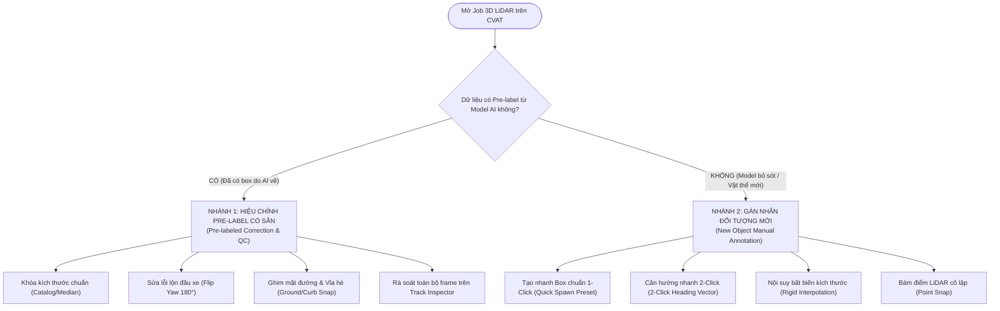
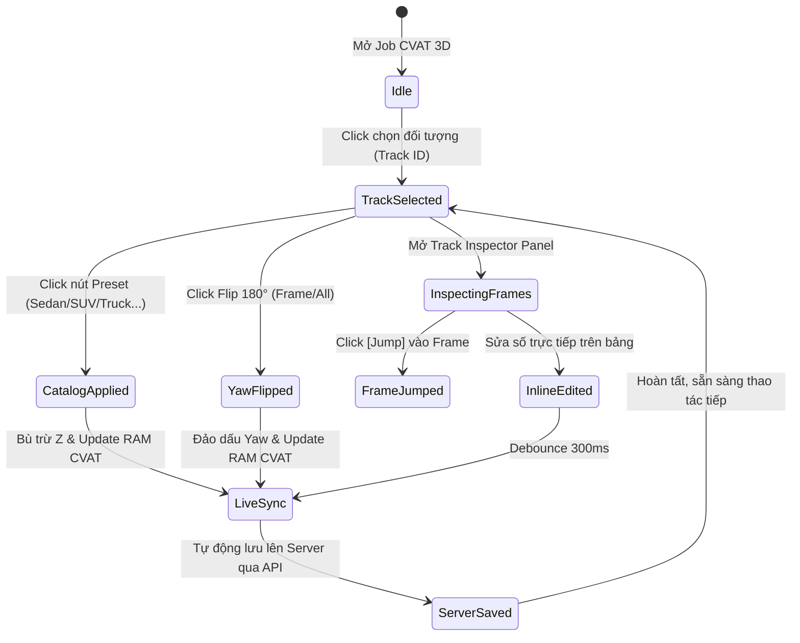

# ĐẶC TẢ USE CASE HỆ THỐNG: CVAT 3D SUITE EXTENSION
> **Tên dự án:** CVAT 3D Point Cloud Annotation & Alignment Assistant (Browser Extension)  
> **Phiên bản tài liệu:** 1.0  
> **Ngày lập:** 2026-10-20  
> **Mục tiêu:** Tối ưu hóa triệt để năng suất gán nhãn 3D LiDAR/Point Cloud trên CVAT, chuyển dịch từ mô hình *Frame-Centric* sang *Track-Centric*, giải quyết triệt để lỗi rung giật kích thước, ngược đầu xe (Yaw flip), và loại bỏ hoàn toàn việc phải F5 tải lại trang.

---

## 1. TỔNG QUAN TÁC NHÂN (ACTORS) VÀ 2 NHÁNH QUY TRÌNH NGHIỆP VỤ

### 1.1. Hai Nhánh Công Việc Chính (Two Core Workflows)

Hệ thống được thiết kế riêng biệt để phục vụ tối ưu cho **cả 2 kịch bản làm việc thực tế**:



| Nhánh công việc | Bối cảnh thực tế | Nhiệm vụ của Extension |
| :--- | :--- | :--- |
| **Nhánh 1: Dữ liệu Pre-label sẵn (Pre-labeled)** | Mô hình AI (PointPillars, CenterPoint...) đã quét trước, nhưng box bị rung giật kích thước, ngược đầu xe, lệch đáy. | Chuẩn hóa hàng loạt: Khóa kích thước chuẩn theo catalog, lật ngược 180° yaw 1-click, làm mịn median, ghim dốc đường, rà soát lỗi trên bảng Inspector. |
| **Nhánh 2: Đánh mới từ đầu (New Manual Object)** | Vật thể bị AI bỏ sót (False Negative) do che khuất hoặc điểm quá thưa. Annotator phải vẽ mới từ con số 0. | Tăng tốc độ vẽ mới: 1-Click đặt ngay box chuẩn kích cỡ tại con trỏ, kéo 2 điểm xác định hướng chạy, tự động khóa kích thước bất biến qua các frame nội suy. |

| Tác nhân (Actor) | Vai trò & Mục đích sử dụng |
| :--- | :--- |
| **Annotator (Kỹ thuật viên gán nhãn 3D)** | Người trực tiếp kéo box, căn chỉnh xe trong cụm điểm LiDAR. Cần thao tác 1-click hoặc phím tắt để chuẩn hóa kích thước, lật đầu xe tức thì, kiểm tra nhanh các frame của một track mà không phải tua thủ công. |
| **QC Inspector / Reviewer (Kiểm soát chất lượng)** | Người rà soát và nghiệm thu các Job. Cần bảng kiểm tra nhanh độ biến thiên kích thước, tự động phát hiện các frame bất thường (ngược đầu xe, lún đất, tốc độ phi lý) để bấm sửa nhanh trước khi duyệt nộp. |
| **Team Lead / Project Manager** | Người quản lý dự án. Cần cấu hình danh mục kích thước xe chuẩn (Catalog) phù hợp với quy chuẩn của từng khách hàng/thị trường (Mỹ, Nhật, Việt Nam...). |

---

## 2. SƠ ĐỒ USE CASE TỔNG THỂ (USE CASE DIAGRAM)

```mermaid
flowchart TD
    subgraph Users ["Người Dùng"]
        A["Annotator (Kỹ thuật viên)"]
        Q["QC Inspector (Kiểm duyệt)"]
    end

    subgraph CoreUC ["Nhóm Căn Chỉnh Kích Thước (Rigid Body Size)"]
        UC1["UC-01: Áp dụng Catalog Kích Thước Chuẩn"]
        UC2["UC-02: Đồng bộ 1 Frame sang Toàn Bộ Track"]
        UC3["UC-03: Tự Động Làm Mịn Kích Thước (Median Filter)"]
        UC4["UC-04: Tự Động Bù Trừ Tâm Z (Ground-Lock)"]
    end

    subgraph YawUC ["Nhóm Xử Lý Hướng Quay (Yaw / Heading)"]
        UC5["UC-05: Lật 180° Frame Hiện Tại (Single Flip)"]
        UC6["UC-06: Lật 180° Toàn Bộ Track (All-Frames Flip)"]
    end

    subgraph TrackUC ["Nhóm Track Inspector & Đồng Bộ Realtime"]
        UC7["UC-07: Hiển Thị Toàn Bộ Frame của ID (Matrix View)"]
        UC8["UC-08: Click Jump Frame (Nhảy Timeline Tức Thì)"]
        UC9["UC-09: Sửa Trực Tiếp & Tự Động Lưu (Auto-Save No-F5)"]
    end

    subgraph QualityUC ["Nhóm Kiểm Tra & Phím Tắt (Auto-QC & Speedrun)"]
        UC10["UC-10: Cảnh Báo Frame Dị Thường (Speed/Yaw/Ground)"]
        UC11["UC-11: Thao Tác Phím Tắt Tốc Độ Cao (Hotkeys)"]
    end

    subgraph TerrainUC ["Nhóm Thích Ứng Địa Hình (Ground & Curb Snap)"]
        UC12["UC-12: Ghim Mặt Đường & Tự Bẻ Hướng Theo Độ Dốc (Road Snap)"]
        UC13["UC-13: Thích Ứng Cao Độ Vỉa Hè (Curb / Sidewalk Offset)"]
    end

    subgraph NewObjectUC ["Nhóm Gán Nhãn Mới (New Object - Nhánh 2)"]
        UC14["UC-14: Tạo Nhanh Box Chuẩn (1-Click Spawn)"]
        UC15["UC-15: Căn Hướng 2 Điểm (2-Click Heading)"]
        UC16["UC-16: Khóa Kích Thước Nội Suy (Rigid Interpolation)"]
    end

    A --> UC1
    A --> UC2
    A --> UC3
    A --> UC5
    A --> UC6
    A --> UC7
    A --> UC8
    A --> UC9
    A --> UC11
    A --> UC12
    A --> UC13
    A --> UC14
    A --> UC15
    A --> UC16

    Q --> UC7
    Q --> UC10
    Q --> UC3
    Q --> UC6

    UC1 -.->|Kèm theo| UC4
    UC2 -.->|Kèm theo| UC4
    UC3 -.->|Kèm theo| UC4
    UC7 -.->|Tích hợp| UC10
```



---

## 3. CHI TIẾT CÁC USE CASE CỐT LÕI

---

### UC-01: Áp Dụng Catalog Kích Thước Chuẩn (Vehicle Catalog Preset)
* **Mô tả:** Cho phép gán kích thước chuẩn của dòng xe tương ứng cho toàn bộ các frame của một track chỉ với 1 cú click.
* **Điều kiện tiên quyết (Pre-conditions):** Annotator đang mở một Job 3D trên CVAT và đã chọn một đối tượng (Track ID).
* **Luồng sự kiện chính (Main Flow):**
  1. Annotator click chọn một xe trên màn hình 3D hoặc trên danh sách đối tượng.
  2. Bảng Extension hiển thị thông tin xe (ID, Loại xe, kích thước hiện tại).
  3. Annotator click vào nút preset: `[Sedan]`, `[SUV]`, `[Truck]`, `[Bus]`, hoặc `[Motorbike]`.
  4. Hệ thống Extension tự động:
     - Đọc kích thước chuẩn: Ví dụ Sedan ($L=4.60m, W=1.80m, H=1.45m$).
     - Tính toán độ chênh lệch chiều cao $\Delta h = H_{mới} - H_{cũ}$.
     - Tự động bù trừ tọa độ tâm $Z_{mới} = Z_{cũ} + \frac{\Delta h}{2}$ (Ground-Lock để cố định mặt đáy bánh xe tiếp đất).
     - Ghi đè vào bộ nhớ RAM của CVAT cho **toàn bộ các frame** mà chiếc xe đó xuất hiện.
  5. Màn hình 3D của CVAT vẽ lại chiếc xe theo kích thước chuẩn ngay lập tức (không cần F5).
  6. Extension gửi lệnh lưu ngầm (Save) lên server.
* **Luồng thay thế (Alternative Flow):** Người dùng có thể tự gõ kích thước tùy chỉnh vào ô $(L, W, H)$ và bấm `[Apply to All Frames]`.

---

### UC-02: Đồng Bộ 1 Frame Ưng Ý Sang Tất Cả Các Frame (Sync Frame to All)
* **Mô tả:** Annotator chỉ cần căn chỉnh chuẩn kích thước $(L, W, H)$ ở một frame đẹp nhất (rõ điểm LiDAR nhất), sau đó bấm 1 nút để sao chép kích thước đó sang 100% các frame còn lại của chiếc xe.
* **Luồng sự kiện chính (Main Flow):**
  1. Annotator căn chỉnh hộp 3D ở frame $K$ thật hoàn hảo.
  2. Trên bảng Extension, bấm nút **"Sync This Frame to All"** (hoặc phím tắt `Shift + S`).
  3. Extension lấy bộ ba kích thước $(L_K, W_K, H_K)$ làm chuẩn.
  4. Quét qua tất cả các frame $i \neq K$ của track đó:
     - Cập nhật $(L_i = L_K, W_i = W_K, H_i = H_K)$.
     - Tính toán bù trừ $Z_i$ tương ứng để đáy xe không bị trồi sụt.
  5. Cập nhật trực tiếp vào canvas CVAT và tự động lưu.

---

### UC-05: Lật Ngược Hướng Đầu Xe 180° (Flip Yaw Heading)
* **Mô tả:** Khắc phục tình trạng mũi tên chỉ hướng xe (Heading/Yaw) bị quay ngược $180^\circ$ so với hướng di chuyển thực tế.
* **Phân loại kịch bản:**
  - **Kịch bản A (Lật 1 frame duy nhất):** Bấm nút `[Flip Current Frame]` hoặc nhấn phím `F`. Hệ thống cộng $\pi$ rad ($180^\circ$) vào góc $rot\_z$ của frame hiện tại, chuẩn hóa về $[-\pi, \pi]$.
  - **Kịch bản B (Lật toàn bộ chuỗi frame của xe):** Bấm nút `[Flip Entire Track]` hoặc nhấn phím `Shift + F`. Hệ thống lật ngược $180^\circ$ góc Yaw cho tất cả các frame của ID đó trong tích tắc.
  - **Kịch bản C (Lật từ frame này trở đi):** Bấm `[Flip Forward Frames]`. Giữ nguyên các frame trước, lật toàn bộ các frame từ frame hiện tại đến frame kết thúc của track.
* **Hậu điều kiện (Post-conditions):** Hướng mũi tên đầu xe quay ngược $180^\circ$ ngay lập tức trên canvas Three.js mà không làm lệch góc Roll và Pitch (góc nghiêng mặt đường).

---

### UC-07: Bảng Điều Khiển Toàn Bộ Frame (Track Inspector Matrix) & Tự Động Lưu Realtime
* **Mô tả:** Khi chọn 1 chiếc xe, Extension mở ra một bảng danh sách (Drawer) hiển thị tất cả các frame của chiếc xe đó, cho phép chỉnh sửa từng ô và tự động lưu mà không cần F5.
* **Giao diện bảng dữ liệu:**
  ```
  ┌────────────────────────────────────────────────────────────────────────────────────────┐
  │ Track ID: #12  |  Label: Car  |  Frames: 45 (Frame 10 ➔ 55)  |  [Flip All] [Lock Sedan]│
  ├───────┬──────────────────────────┬─────────────┬─────────────┬──────────────┬──────────┤
  │ Frame │ Tọa độ (X, Y, Z)         │ Yaw (°)     │ Kích thước  │ Trạng thái   │ Nhảy tới │
  ├───────┼──────────────────────────┼─────────────┼─────────────┼──────────────┼──────────┤
  │ 10    │ 14.20, -5.10, -0.90      │ 175.2°      │ 4.6×1.8×1.5 │ Keyframe     │ [Jump]   │
  │ 11    │ 14.45, -5.08, -0.90      │ 175.0°      │ 4.6×1.8×1.5 │ Interpolated │ [Jump]   │
  │ 12    │ 14.70, -5.05, -0.90      │ -4.8° [!]   │ 4.6×1.8×1.5 │ Lệch Yaw!    │ [Flip]   │
  │ ...   │ ...                      │ ...         │ ...         │ ...          │ ...      │
  └───────┴──────────────────────────┴─────────────┴─────────────┴──────────────┴──────────┘
  ```
* **Luồng tương tác:**
  1. Click vào nút `[Jump]` hoặc click đúp vào dòng Frame $\rightarrow$ Timeline của CVAT lập tức chuyển đến frame đó, camera 3D focus vào chiếc xe để người dùng quan sát điểm LiDAR.
  2. Bấm nút `[Flip]` ngay trên dòng frame bị lệch $\rightarrow$ Sửa tức thì góc quay của frame đó.
  3. Sửa số trực tiếp trong ô dữ liệu (Inline Editing) $\rightarrow$ Extension bắt sự kiện `onBlur` hoặc `debounce 300ms`, áp dụng thẳng vào RAM CVAT và đẩy PATCH lên server ngầm.

---

### UC-10: Cảnh Báo Dị Thường Tự Động (Auto-QC 3D Linter)
* **Mô tả:** Tự động phát hiện lỗi sai hình học và động học mà không cần người dùng phải căng mắt soi từng frame.
* **Các quy tắc kiểm tra (Rules):**
  1. **Quy tắc Yaw giật cục (Yaw Jitter / Inversion):** Nếu góc Yaw của frame $i$ lệch so với frame $i-1$ lớn hơn $90^\circ$ $\rightarrow$ Đánh dấu đỏ `[Cảnh báo ngược đầu xe]`.
  2. **Quy tắc Kích thước biến thiên (Dimension Invariance):** Nếu kích thước $L, W, H$ tại frame $i$ chênh lệch $> 5cm$ so với trung vị của track $\rightarrow$ Đánh dấu vàng `[Lệch kích thước]`.
  3. **Quy tắc Vận tốc phi lý (Kinematic Outlier):** Nếu khoảng cách di chuyển giữa 2 frame liên tiếp tương đương vận tốc $> 120km/h$ đối với xe ô tô hoặc $> 40km/h$ đối với người đi bộ $\rightarrow$ Đánh dấu đỏ `[Nhảy vọt vị trí / Teleport]`.
  4. **Quy tắc Chìm/Bay (Ground Contact):** Nếu mặt đáy thấp hơn mặt phẳng đường $> 15cm$ $\rightarrow$ Đánh dấu đỏ `[Lún mặt đường]`.

---

### UC-12: Ghim Mặt Đường & Tự Động Bẻ Hướng Theo Độ Dốc (Road Plane Snap & Pitch/Roll Fitting)
* **Mô tả:** Khi xe di chuyển trên đoạn đường dốc (Incline / Slope) hoặc nghiêng lòng máng (Camber / Bank Angle), xe không nằm phẳng ngang mà phải chúi đầu hoặc nghiêng thân theo mặt đường. Tính năng này tự động "bẻ hướng" (Roll & Pitch) và hút đáy hộp (Snap Z) khớp khít với mặt đường.
* **Luồng sự kiện chính (Main Flow):**
  1. Annotator click chọn xe trên đoạn đường dốc/nghiêng.
  2. Bấm nút **[Ghim Mặt Đường] (Snap to Road)** hoặc phím tắt `G`.
  3. Thuật toán của Extension:
     - Trích xuất cụm điểm LiDAR mặt đất (Ground points) xung quanh và dưới gầm xe trong bán kính $R \approx 3.0m$.
     - Ước lượng mặt phẳng đường cục bộ $Ax + By + Cz + D = 0$ thông qua thuật toán RANSAC Plane Fitting / Vector pháp tuyến $\vec{n} = (A, B, C)$.
     - **Tự động bẻ góc:**
       - Tính góc dốc dọc (**Pitch**): Bẻ góc nâng/chúi đầu xe khớp với độ dốc của mặt đường.
       - Tính góc nghiêng ngang (**Roll**): Bẻ góc nghiêng sườn xe khớp với độ nghiêng lòng đường.
       - **Bảo toàn góc Yaw:** Giữ nguyên hướng mũi tên xe chạy dọc theo làn đường.
     - **Ghim cao độ Z:** Điều chỉnh $Z_{center}$ sao cho mặt phẳng đáy của cuboid áp sát đúng vào mặt phẳng đường vừa ước lượng.
  4. Màn hình 3D CVAT hiển thị chiếc xe nằm khớp khít với mặt dốc của đường, 4 bánh xe chạm sát mặt điểm LiDAR.

---

### UC-13: Xử Lý Địa Hình Vỉa Hè / Bậc Nâng Độ Cao (Sidewalk & Curb Height Offset)
* **Mô tả:** Xử lý các tình huống xe, xe máy, người đi bộ nằm trên vỉa hè (thường cao hơn mặt đường 10–20cm) hoặc xe đỗ gác bánh lên vỉa hè (nửa trên vỉa hè, nửa dưới lòng đường).
* **Các chế độ hỗ trợ (Modes):**
  1. **Chế độ Trên Vỉa Hè (On-Sidewalk Snap):**
     - Khi đối tượng nằm trên vỉa hè, thuật toán tự động nhận diện cụm điểm mặt vỉa hè (dựa trên phân bố cao độ $Z$-histogram phát hiện bậc nhảy $\approx +15cm$).
     - Tự động nâng cao độ đáy xe lên khớp với mặt phẳng bê tông của vỉa hè, tránh việc xe bị chìm 15cm bánh vào lòng vỉa hè.
  2. **Chế độ Đỗ Gác Bánh Lên Vỉa Hè (Half-on-Curb Parking):**
     - Áp dụng khi xe đỗ nghiêng: 2 bánh bên phải nằm trên vỉa hè ($Z_{high}$), 2 bánh bên trái nằm dưới lòng đường ($Z_{low}$).
     - Bấm nút `[Gác Vỉa Hè (Half-Curb)]`: Extension tự động tính toán góc nghiêng thân xe:
       $$Roll = \arcsin\left(\frac{H_{curb}}{W_{car}}\right)$$
       *(Ví dụ vỉa hè cao $15cm$, xe rộng $1.8m$ $\rightarrow$ Xe nghiêng khoảng $4.8^\circ$).*
     - Đồng thời nâng tâm $Z$ lên một đoạn $\frac{H_{curb}}{2}$ để đảm bảo 2 bánh trên chạm vỉa hè và 2 bánh dưới chạm lòng đường chuẩn xác 100%.

---

### UC-14: Khởi Tạo Nhanh Box Chuẩn Kích Thước (Quick 1-Click 3D Spawn - Nhánh 2)
* **Mô tả:** Khi phát hiện một đối tượng bị model bỏ sót, thay vì phải dùng công cụ vẽ mặc định của CVAT sinh ra một box méo mó rồi dùng chuột kéo nắn 6 mặt phẳng, annotator chỉ cần 1 cú click là box chuẩn xuất hiện.
* **Luồng sự kiện chính (Main Flow):**
  1. Annotator phát hiện cụm điểm xe chưa được vẽ.
  2. Nhấn phím tắt nhanh (ví dụ `C` cho Car, `T` cho Truck, `B` cho Bus, `M` cho Motorbike).
  3. Click chuột vào cụm điểm LiDAR trên màn hình:
     - Extension tự động sinh ra một 3D Cuboid với **kích thước chuẩn của Catalog 100%** (ví dụ Sedan $4.6 \times 1.8 \times 1.45m$).
     - Đáy xe tự động hút khớp vào mặt đường (Ground Snap).
  4. Annotator chỉ cần xoay đúng hướng là hoàn thành khởi tạo (giảm 80% thời gian tạo box mới).

---

### UC-15: Định Hướng Đầu Xe Nhanh Bằng 2 Click (2-Click Heading Vector - Nhánh 2)
* **Mô tả:** Căn góc quay Yaw chính xác cho đối tượng mới tạo mà không cần dùng vòng xoay góc chuột 3D.
* **Luồng sự kiện chính (Main Flow):**
  1. Sau khi đặt box vào cụm điểm, annotator giữ phím `V` (Vector Heading).
  2. Click chuột vào **Điểm 1 (Đuôi xe)** ➔ Click chuột vào **Điểm 2 (Đầu xe)** trên cụm điểm LiDAR.
  3. Extension tính góc:
     $$Yaw = \text{atan2}(y_2 - y_1, x_2 - x_1)$$
  4. Hộp 3D tự động xoay trục chính theo đúng vector từ đuôi đến đầu xe, mũi tên chỉ hướng khớp hoàn hảo với hướng xe di chuyển.

---

### UC-16: Khóa Kích Thước Bất Biến Khi Tạo Track & Nội Suy (Rigid Track Interpolation - Nhánh 2)
* **Mô tả:** Đảm bảo khi vẽ xe mới qua nhiều frame (Tracking), kích thước xe không bị biến dạng giữa các Keyframe.
* **Luồng sự kiện chính (Main Flow):**
  1. Annotator tạo box ở Frame bắt đầu (Keyframe 1).
  2. Nhảy timeline đến Frame kết thúc (Keyframe 2, ví dụ frame 40), di chuyển vị trí và xoay góc xe khớp với cụm điểm ở frame 40.
  3. Extension tự động kích hoạt cơ chế **Rigid Body Interpolation**:
     - Khóa cứng kích thước $(L, W, H)$ ở mọi frame nội suy từ 1 đến 40 theo đúng kích thước ban đầu.
     - CVAT chỉ tính toán nội suy vị trí $(X, Y, Z)$ và góc $Yaw$, triệt tiêu hoàn toàn lỗi box bị phập phồng hay co giãn trong quá trình di chuyển.

---

## 4. MA TRẬN PHÂN QUYỀN VÀ TRẠNG THÁI (STATE TRANSITION)



---

## 5. CÁC TÌNH HUỐNG NGOẠI LỆ & PHÒNG VỆ (EDGE CASES & DEFENSIVE RULES)

1. **Khi đối tượng bị mất dấu (Occlusion / Keyframe xóa điểm):**
   * Nếu ở frame $K$ đối tượng bị ẩn (hidden) hoặc kết thúc track: Extension tự động bỏ qua frame ẩn, không can thiệp vẽ box rỗng.
2. **Khi người dùng đang chọn đối tượng không phải 3D Cuboid (Polygon, 2D Box):**
   * Extension nhận diện `shape.type !== "cuboid"` $\rightarrow$ Hiển thị trạng thái ẩn/vô hiệu hóa các nút chức năng 3D, không gây lỗi logic cho CVAT.
3. **Mạng chập chờn hoặc Server CVAT phản hồi chậm:**
   * Extension áp dụng cơ chế **Optimistic UI**: Thay đổi hình học hiển thị ngay lập tức trên canvas để người dùng tiếp tục làm việc, việc gọi lưu API chạy trong hàng đợi nền (Background queue) có Retry tự động nếu gặp lỗi 502/504.
4. **Tránh xung đột phím tắt mặc định của CVAT:**
   * Các phím tắt của Extension chỉ hoạt động khi con trỏ chuột không nằm trong ô nhập text và có thể dễ dàng bật/tắt (Toggle Hotkeys on/off) bằng 1 nút gạt trên giao diện.
