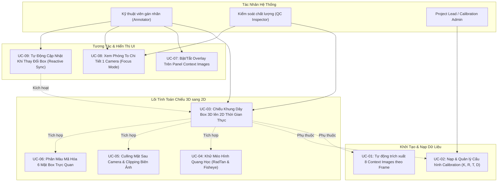
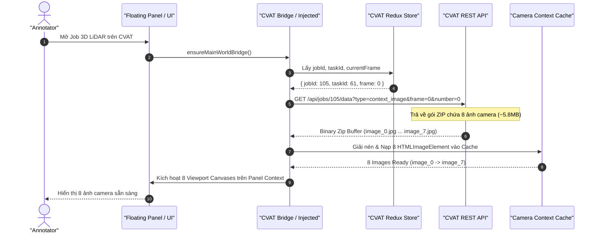
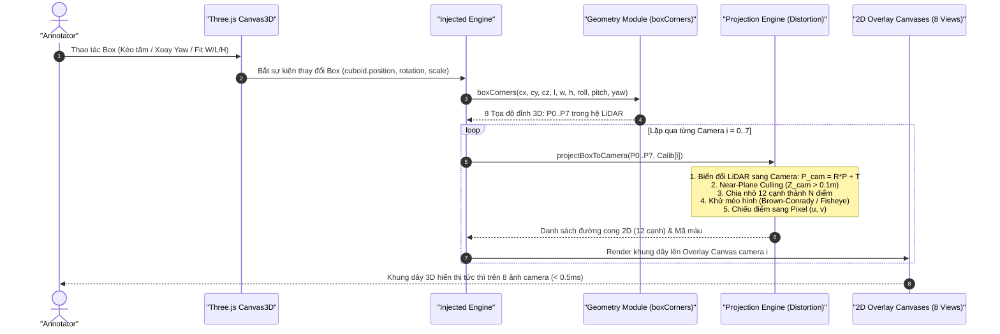
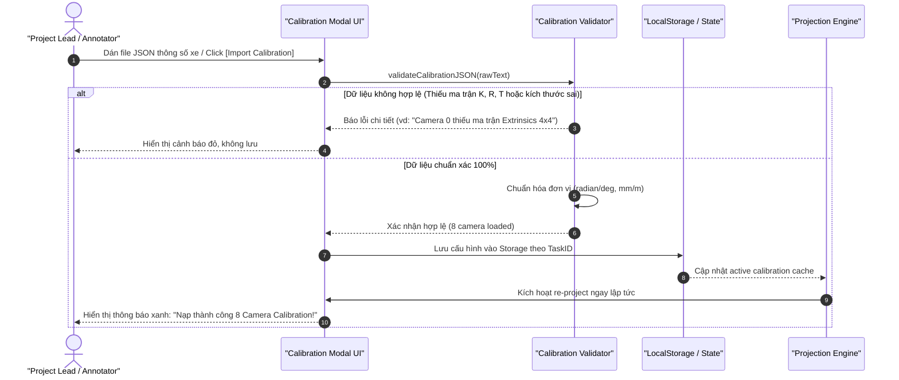
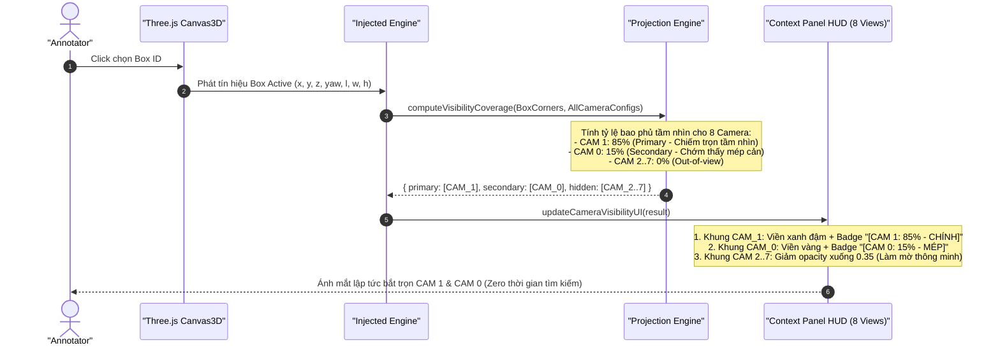

# ĐẶC TẢ USE CASE & SEQUENCE DIAGRAM: TÍNH NĂNG CHIẾU 3D BOX LÊN 2D CONTEXT IMAGES
> **Tên module:** 3D-to-2D Wireframe Projection & Lens Distortion Engine  
> **Dự án:** CVAT 3D Point Cloud Annotation & Alignment Assistant  
> **Phiên bản:** 1.0  
> **Ngày lập:** 2026-10-23  
> **Trạng thái:** Thiết kế chi tiết & Đặc tả kiến trúc (Architecture Spec)

---

## 1. TỔNG QUAN & BỐI CẢNH KỸ THUẬT (ENGINEERING CONTEXT)

### 1.1. Vấn Đề Thực Tế Cần Giải Quyết
Trong quá trình gán nhãn 3D Bounding Box (Cuboid) trên mây điểm LiDAR tại `cvat.itup.io.vn`:
1. **Điểm thưa & Che khuất ở xa**: Các phương tiện hoặc người đi bộ ở khoảng cách xa (>25m) hoặc bị khuất chỉ có rất ít điểm phản xạ LiDAR (dưới 10 điểm), khiến annotator khó xác định chính xác mép cản trước/sau, lốp xe, sườn xe hay gương chiếu hậu.
2. **Khác biệt không gian 3D vs 2D**: Mặc dù CVAT đã có sẵn dữ liệu 8 ảnh camera context (`image_0.jpg` $\to$ `image_7.jpg`), annotator chỉ có thể nhìn mắt đối chiếu tách biệt, không thể biết chính xác hộp 3D mình vừa vẽ/fit có khớp khít với viền xe trên ảnh thật hay không.
3. **Hiện tượng méo hình ống kính (Lens Distortion)**: Các camera góc rộng (Wide-Angle) và camera mắt cá (Fisheye như WoodScape, FishEye8K) có độ cong méo rất lớn ở vùng rìa ảnh. Phép chiếu Pinhole thẳng thông thường sẽ làm khung xe bị lệch hoàn toàn so với hình ảnh thực tế.

### 1.2. Mục Tiêu Của Tính Năng
- **Căn chỉnh chính xác tuyệt đối cho mây điểm thưa ở xa (Sparse Point Cloud Box Fitting)**: Với các vật thể ở xa (>25m) hoặc bị khuất chỉ có 3–10 điểm LiDAR rời rạc, tính năng chiếu 3D sang 2D cho phép annotator nhìn trực tiếp vào ảnh camera độ phân giải cao để căn khít mép cản trước/sau, lốp xe, sườn xe và gương chiếu hậu.
- **Định vị Camera thông minh thời gian thực (Smart Camera Visibility & Auto-Highlight)**: Khi annotator click chọn hoặc đang vẽ một đối tượng, hệ thống tự động tính toán hình nón quan sát (Frustum Intersection) và chỉ định ngay lập tức: *"Đối tượng đang nằm 85% trên Camera 1 (CAM_FRONT_LEFT) và 15% trên Camera 2 (CAM_FRONT)"*. Tự động highlight viền xanh và đưa camera chính lên tầm mắt, loại bỏ 100% thời gian annotator phải căng mắt soi tìm trong 8 khung ảnh nhỏ.
- **Kiến trúc mở sẵn sàng cho Module AI Tự Nhận Diện Kích Thước 2D sang 3D (AI 2D-to-3D Dimension Estimator)**: Trích xuất chính xác vùng ảnh bao quanh vật thể (2D Bounding Box ROI) để trong tương lai có thể đưa qua mô hình AI (YOLO-3D / ResNet / ViT) tự động nhận diện thương hiệu/dòng xe (Sedan VinFast VF8, VF9, SUV, Bus) và dự đoán bộ kích thước $(L, W, H)$ gán ngược lại cho 3D Box.
- **Chiếu thời gian thực (Realtime 60fps / $<0.5\text{ms}$)**: Tính toán hình chiếu của 8 đỉnh và 12 cạnh khung dây 3D lên toàn bộ 8 camera context images ngay khi người dùng kéo chuột, xoay Yaw, căn W/L/H hay bấm Auto-Fit.
- **Khử méo hình học chính xác**: Tích hợp cả mô hình méo xuyên tâm/tiếp tuyến **Brown-Conrady** (OpenCV RadTan) và mô hình góc siêu rộng **Fisheye Kannala-Brandt**.
- **Chia nhỏ cạnh cong (Adaptive Edge Sub-division)**: Các cạnh thẳng của hộp 3D khi qua ống kính mắt cá được tự động chia thành các đoạn cong mượt mà bám khít hình học quang học của camera.
- **Mã hóa màu sắc trực quan theo chuẩn tự hành (Standard Color Coding)**:
  - Mặt trước (Front): **Màu Đỏ (#ef4444)**
  - Sườn trái (Left): **Màu Xanh Lục (#22c55e)**
  - Sườn phải (Right): **Màu Xanh Ngọc / Cyan (#06b6d4)**
  - Mặt sau (Rear): **Màu Xanh Dương (#3b82f6)**
  - Nóc xe (Roof): **Màu Vàng (#eab308)**

---

## 2. SƠ ĐỒ USE CASE TỔNG THỂ (USE CASE DIAGRAM)



---

## 3. CHI TIẾT CÁC USE CASE ĐẶC TẢ

### UC-01: Tự Động Trích Xuất 8 Context Images Theo Frame
* **Tác nhân:** Hệ thống (tự động) / Annotator
* **Mô tả:** Khi người dùng chuyển đổi frame trên timeline của CVAT, hệ thống tự động nhận diện gói ảnh context tương ứng của frame đó (`image_0.jpg` $\to$ `image_7.jpg`), sẵn sàng cho việc vẽ khung dây đè lên.
* **Tiền điều kiện:** Job 3D trên CVAT có `"has_related_context": true` và `"related_files": 8`.
* **Luồng sự kiện chính:**
  1. Người dùng chuyển sang frame mới $F$ (qua phím `F`, `D`, slider hoặc Track Studio).
  2. Injected Script phát hiện sự kiện đổi frame từ `state.annotation.player.frame.number`.
  3. Hệ thống kiểm tra cache ảnh của frame $F$:
     - Nếu đã cache: Kích hoạt vẽ lại tức thì.
     - Nếu chưa cache: Gọi API ngầm `GET /api/jobs/{id}/data?type=context_image&frame={F}&number=0` giải nén và nạp 8 ảnh vào ImageCache.
  4. Gán nguồn ảnh vào các Canvas Context View trên giao diện.

---

### UC-02: Nạp & Quản Lý Cấu Hình Calibration ($K, R, T, D$)
* **Tác nhân:** Project Lead / Annotator
* **Mô tả:** Cho phép nạp bộ thông số hiệu chuẩn camera của xe từ file cấu hình (JSON/YAML) hoặc lưu trong LocalStorage theo từng Task ID/Job ID.
* **Cấu trúc dữ liệu Calibration:**
  - `intrinsics`: Ma trận nội tại $3 \times 3$ hoặc bộ $(f_x, f_y, c_x, c_y)$.
  - `extrinsics`: Ma trận chuyển đổi từ tọa độ LiDAR sang Camera $[R \mid T]$ ($4 \times 4$).
  - `distortion`: Mô hình méo hình (`radtan` hoặc `fisheye`) kèm mảng hệ số $[k_1, k_2, p_1, p_2, k_3]$ hoặc $[k_1, k_2, k_3, k_4]$.
  - `image_size`: Độ phân giải gốc của ảnh $(W, H)$.
* **Luồng sự kiện chính:**
  1. Người dùng mở mục "Cấu hình Camera Calibration" trên Floating Panel.
  2. Chọn nạp file JSON mẫu hoặc dán trực tiếp chuỗi JSON cấu hình.
  3. Hệ thống validate ma trận (kiểm tra tính khả nghịch, kích thước $3 \times 3$, $4 \times 4$).
  4. Lưu cấu hình vào `localStorage` gắn liền với `taskId`.
  5. Kích hoạt vẽ lại toàn bộ các camera view.

---

### UC-03: Chiếu Khung Dây Box 3D Lên 2D Thời Gian Thực (60fps)
* **Tác nhân:** Annotator / QC Inspector
* **Mô tả:** Tính toán tọa độ 2D của 8 đỉnh và 12 cạnh khung dây từ hộp 3D đang chọn, vẽ đè lên 8 khung ảnh camera với độ trễ $< 0.5\text{ms}$.
* **Tiền điều kiện:** Có ít nhất một hộp 3D đang active và thông số Calibration đã được nạp.
* **Luồng sự kiện chính:**
  1. Lấy thông số 3D của box: Tâm $(c_x, c_y, c_z)$, kích thước $(L, W, H)$, góc xoay $(Roll, Pitch, Yaw)$.
  2. Gọi `boxCorners(...)` tính 8 đỉnh trong hệ tọa độ LiDAR: $P_0, P_1, \dots, P_7$.
  3. Lặp qua từng camera $i \in [0..7]$:
     - Biến đổi 8 đỉnh sang hệ tọa độ Camera: $P^{(c)}_k = R_i \cdot P_k + T_i$.
     - Kiểm tra điều kiện Culling: Nếu tất cả 8 đỉnh đều có $Z^{(c)} \le 0.1\text{m}$, bỏ qua camera này (vật thể nằm sau lưng camera).
     - Với các cạnh có 1 đỉnh sau lưng và 1 đỉnh phía trước: Cắt cạnh tại mặt phẳng $Z^{(c)} = 0.1\text{m}$ (Near Plane Clipping).
     - Khử méo hình học: Chiếu các đỉnh và các điểm nội suy trên cạnh sang tọa độ pixel $(u, v)$ trên ảnh.
     - Vẽ 12 cạnh khung dây lên Canvas 2D overlay của camera $i$.

---

### UC-04: Xử Lý Khử Méo Hình Quang Học (Lens Distortion & Curve Subdivision)
* **Tác nhân:** Hệ thống (tự động)
* **Mô tả:** Đối với camera mắt cá hoặc góc rộng, một cạnh thẳng trong không gian 3D khi phản chiếu qua thấu kính cong sẽ biến thành đường cong trên ảnh 2D. Thuật toán tự động chia nhỏ cạnh thành các đoạn nội suy và uốn cong theo đúng thông số méo hình.
* **Mô hình toán học:**
  - **Mô hình Brown-Conrady (RadTan / Góc rộng)**:
    $$x' = \frac{X^{(c)}}{Z^{(c)}}, \quad y' = \frac{Y^{(c)}}{Z^{(c)}}, \quad r^2 = x'^2 + y'^2$$
    $$x'' = x'(1 + k_1 r^2 + k_2 r^4 + k_3 r^6) + 2p_1 x' y' + p_2(r^2 + 2x'^2)$$
    $$y'' = y'(1 + k_1 r^2 + k_2 r^4 + k_3 r^6) + p_1(r^2 + 2y'^2) + 2p_2 x' y'$$
    $$u = f_x \cdot x'' + c_x, \quad v = f_y \cdot y'' + c_y$$
  - **Mô hình Fisheye Kannala-Brandt (Mắt cá)**:
    $$r = \sqrt{x'^2 + y'^2}, \quad \theta = \arctan(r)$$
    $$\theta_d = \theta(1 + k_1 \theta^2 + k_2 \theta^4 + k_3 \theta^6 + k_4 \theta^8)$$
    $$x'' = \frac{\theta_d}{r} x', \quad y'' = \frac{\theta_d}{r} y'$$
    $$u = f_x \cdot x'' + c_x, \quad v = f_y \cdot y'' + c_y$$
  - **Chia nhỏ cạnh thích ứng (Subdivision)**: Mỗi cạnh trong 12 cạnh được chia thành 8 đoạn nhỏ trong không gian 3D trước khi chiếu, sau đó nối lại bằng nét vẽ đường cong `ctx.lineTo(u, v)` mềm mại trên Canvas 2D.

---

### UC-08: Xem Phóng To Chi Tiết 1 Camera (Focus Mode)
* **Tác nhân:** Annotator / QC Inspector
* **Mô tả:** Cho phép click đúp hoặc bấm phím tắt vào 1 trong 8 camera để phóng to toàn màn hình (Modal Focus View), hỗ trợ zoom/pan để soi từng chi tiết mép cản đón tia, mép lốp xe, vạch kẻ làn.
* **Luồng sự kiện chính:**
  1. Annotator click đúp vào Camera Front (`image_0`).
  2. Màn hình Focus Modal mở ra với độ phân giải gốc 100% (High-res Canvas).
  3. Khung dây 3D hiển thị chi tiết với độ dày viền nét thanh mảnh ($1\text{px} \sim 2\text{px}$) kèm nhãn thông số $(L, W, H)$.
  4. Người dùng có thể lăn chuột để phóng to $200\% \sim 500\%$.
  5. Các thao tác vi chỉnh phím tắt ($\pm 1\text{cm}, \pm 5\text{cm}$) trên bàn phím vẫn hoạt động và khung dây dịch chuyển trực tiếp trong chế độ phóng to này.

---

### UC-10: Định Vị Camera Thông Minh & Tự Động Highlight Realtime (Smart Camera Visibility & Auto-Highlight)
* **Tác nhân:** Hệ thống (tự động) / Annotator
* **Mô tả:** Loại bỏ hoàn toàn việc annotator phải căng mắt soi tìm đối tượng trong 8 khung ảnh nhỏ. Khi chọn hoặc vẽ một box 3D, hệ thống tự động tính toán mức độ bao phủ tầm nhìn (Visibility Coverage) và chỉ định ngay lập tức: *"Đối tượng này nằm trên Camera nào, chiếm bao nhiêu % diện tích"*.
* **Thuật toán tính độ bao phủ tầm nhìn (Visibility Coverage Algorithm):**
  1. Với mỗi camera $i \in [0..7]$, chiếu 8 đỉnh của Box sang không gian camera $P^{(c)} = R_i \cdot P + T_i$.
  2. Đỉnh được coi là hợp lệ (in-frustum) nếu $Z^{(c)} > 0.1\text{m}$ và pixel $(u, v)$ nằm trong khung hình $[0, W_{\text{img}}] \times [0, H_{\text{img}}]$.
  3. Tính hình chữ nhật bao quanh 2D (2D Bounding Box ROI):
     $$u_{\min} = \min(u_k), \quad u_{\max} = \max(u_k), \quad v_{\min} = \min(v_k), \quad v_{\max} = \max(v_k)$$
  4. Tính diện tích giao cắt với khung hình $S_{\text{intersect}}$ và diện tích hộp 2D $S_{\text{box2D}}$.
  5. Tỷ lệ bao phủ tầm nhìn:
     $$\text{Visibility}_i = \frac{S_{\text{intersect}}}{S_{\text{box2D}}} \times 100\%$$
  6. Phân loại mức độ ưu tiên:
     - **Primary Camera (Camera chính)**: Camera có tỷ lệ $\text{Visibility}$ lớn nhất và $\ge 25\%$.
     - **Secondary Camera (Camera phụ / Chớm thấy)**: Camera có $0\% < \text{Visibility} < 25\%$ (chỉ thấy một phần đuôi/đầu xe).
     - **Out-of-view**: $\text{Visibility} = 0\%$ (vật thể nằm ngoài góc quay hoặc sau lưng camera).
* **Luồng sự kiện chính:**
  1. Annotator click chọn Box ID #3 trên màn hình 3D.
  2. Hệ thống tính toán tức thì trong $< 0.1\text{ms}$:
     - `CAM_FRONT_LEFT` (Camera 1): Nhìn thấy 85% vật thể $\to$ **Primary Camera**.
     - `CAM_FRONT` (Camera 0): Nhìn thấy 15% vật thể (chớm thấy mép cản phải) $\to$ **Secondary Camera**.
     - 6 Camera còn lại: 0% $\to$ **Out-of-view**.
  3. Cập nhật giao diện Context Panel tức thì:
     - Khung Camera 1 phát sáng viền xanh lá đậm `#22c55e` kèm nhãn nổi bật: `[CAM 1: 85% - CHÍNH]`.
     - Khung Camera 0 hiển thị viền vàng `#eab308` kèm nhãn: `[CAM 0: 15% - CHỚM GÓC]`.
     - 6 Camera không nhìn thấy tự động mờ nhẹ (opacity 0.35) để ánh mắt annotator tập trung 100% vào đúng 2 camera liên quan.
  4. Khi annotator kéo box di chuyển sang vị trí khác, nhãn highlight tự động nhảy theo thời gian thực 60fps!

---

### UC-11: Cung Cấp Dữ Liệu ROI Cho Module AI Tự Nhận Diện Thông Số Xe (AI 2D-to-3D Ready)
* **Tác nhân:** Module AI (Tương lai) / Annotator
* **Mô tả:** Thiết kế kiến trúc mở, cho phép trích xuất chính xác vùng ảnh (ROI - Region of Interest) của đối tượng từ Camera chính để cấp dữ liệu cho mô hình Deep Learning tự động nhận diện dòng xe và ước lượng kích thước $(L, W, H)$.
* **Luồng sự kiện chính:**
  1. Khi người dùng click nút "AI Auto-Detect Size" (hoặc tự động kích hoạt khi tạo box mới):
  2. Hệ thống xác định Camera chính có góc nhìn rõ nhất từ UC-10.
  3. Trích xuất ảnh crop ROI với độ phân giải gốc kèm padding nhẹ $10\%$.
  4. Gói dữ liệu ảnh ROI và góc nhìn camera (Front / Side / Rear) sẵn sàng gửi tới endpoint mô hình AI phân loại (hoặc chạy mô hình ONNX Web runtime nhẹ).
  5. Kết quả trả về kích thước chuẩn $(L, W, H)$ tự động điền vào box 3D tương ứng.

---

## 4. CÁC SƠ ĐỒ TUẦN TỰ HỆ THỐNG (SEQUENCE DIAGRAMS)

### 4.1. Sequence 1: Khởi Tạo Hệ Thống & Nạp Dữ Liệu Camera Context Images



---

### 4.2. Sequence 2: Chiếu Khung Dây Thời Gian Thực Khi Thao Tác 3D (Kéo/Fit/Xoay Box)



---

### 4.3. Sequence 3: Xử Lý Khử Méo Hình Học & Chia Nhỏ Cạnh Cong Thấu Kính

```mermaid
sequenceDiagram
    autonumber
    participant Engine as "Projection Engine"
    participant Math as "Lens Math Model"
    participant Canvas as "Canvas 2D Context"

    Engine->>Engine: Nhận 1 cạnh 3D nối giữa 2 đỉnh (P_start, P_end)
    Engine->>Engine: Chia nhỏ cạnh thành N=8 điểm nội suy: Q_0, Q_1, ..., Q_8
    
    loop Với mỗi điểm Q_k trong không gian Camera (X, Y, Z)
        Engine->>Math: computeDistortion(X_k, Y_k, Z_k, Intrinsics, DistCoeffs)
        alt Mô hình RadTan (Brown-Conrady)
            Math->>Math: Áp dụng đa thức r^2, r^4, r^6 và hệ số k1, k2, p1, p2, k3
        else Mô hình Fisheye (Kannala-Brandt)
            Math->>Math: Áp dụng góc theta = atan(r) và đa thức theta_d
        end
        Math-->>Engine: Tọa độ pixel (u_k, v_k) đã khử méo
    end
    
    Engine->>Canvas: ctx.beginPath()
    Engine->>Canvas: ctx.moveTo(u_0, v_0)
    loop k = 1..8
        Engine->>Canvas: ctx.lineTo(u_k, v_k)
    end
    Engine->>Canvas: ctx.strokeStyle = EdgeColor; ctx.stroke()
    Note over Canvas: Cạnh thẳng trong 3D hiển thị thành đường cong quang học hoàn hảo
```

---

### 4.4. Sequence 4: Nạp Cấu Hình Calibration & Validate Ma Trận



---

### 4.5. Sequence 5: Định Vị Camera Thông Minh & Tự Động Highlight Realtime (Auto-Focus Indicator)



---

## 5. MA TRẬN 8 CAMERA VINFAST ADAS & QUY ƯỚC HÌNH HỌC

Dựa trên cấu trúc 8 camera quan sát toàn cảnh 360° của xe tự hành VinFast:

| Camera Index | File ảnh gốc | Tên Camera | Góc nhìn | Ống kính khuyến nghị |
| :---: | :---: | :---: | :---: | :---: |
| **0** | `image_0.jpg` | **CAM_FRONT** | Trước đầu xe chính diện | Góc rộng (Wide FOV ~120°) |
| **1** | `image_1.jpg` | **CAM_FRONT_LEFT** | Trước góc chéo bên trái | Mắt cá / Góc rộng (~120°) |
| **2** | `image_2.jpg` | **CAM_FRONT_RIGHT** | Trước góc chéo bên phải | Mắt cá / Góc rộng (~120°) |
| **3** | `image_3.jpg` | **CAM_SIDE_LEFT** | Sườn xe bên trái (gương trái) | Mắt cá Fisheye (~180°) |
| **4** | `image_4.jpg` | **CAM_SIDE_RIGHT** | Sườn xe bên phải (gương phải) | Mắt cá Fisheye (~180°) |
| **5** | `image_5.jpg` | **CAM_BACK_LEFT** | Sau góc chéo bên trái | Mắt cá / Góc rộng (~120°) |
| **6** | `image_6.jpg` | **CAM_BACK_RIGHT** | Sau góc chéo bên phải | Mắt cá / Góc rộng (~120°) |
| **7** | `image_7.jpg` | **CAM_BACK** | Đuôi xe chính diện (Camera lùi) | Mắt cá Fisheye (~180°) |

---

## 6. QUY TẮC PHÒNG VỆ KỸ THUẬT & KHÁNG LỖI (DEFENSIVE RULES)

1. **Phòng vệ điểm âm ($Z_{\text{cam}} \le 0$)**:
   - Nếu vật thể nằm sau lưng ống kính ($Z \le 0$), việc chia $u = f_x \frac{X}{Z}$ sẽ tạo ra tọa độ bị đảo ngược $180^\circ$ trên màn hình.
   - **Giải pháp**: Áp dụng Near-Plane Clipping tại mặt phẳng an toàn $Z_{\text{clip}} = 0.1\text{m}$. Nếu cả 2 đầu của một cạnh đều có $Z \le 0.1\text{m}$, bỏ qua không vẽ cạnh đó.
2. **Kháng tràn biên Canvas (Boundary Clipping)**:
   - Các điểm chiếu ra ngoài vùng kích thước ảnh $([0, W], [0, H])$ được giới hạn an toàn để không làm treo bộ đệm đồ họa Canvas 2D.
3. **Phòng vệ rỗng thông số (Fallback Mode)**:
   - Nếu chưa nạp thông số Calibration cho một camera: Giữ nguyên ảnh gốc, hiển thị thông báo mờ *"Chưa có Calibration"* trên góc ảnh, tuyệt đối không gây văng giao diện (No Crash / Zero Regression).
4. **Hiệu năng cao (Zero-Garbage Collection trong luồng Render)**:
   - Tái sử dụng mảng tọa độ tĩnh `Float32Array` trong `projection.ts` để hạn chế cấp phát bộ nhớ liên tục trong vòng lặp 60fps, loại bỏ hiện tượng giật khung hình do Garbage Collector của trình duyệt.
